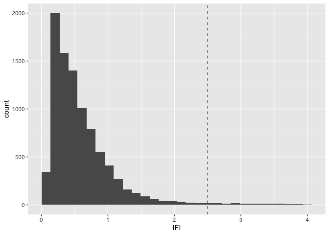
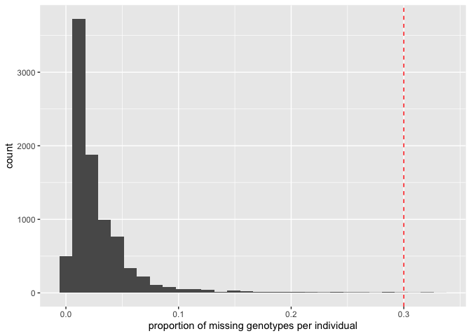
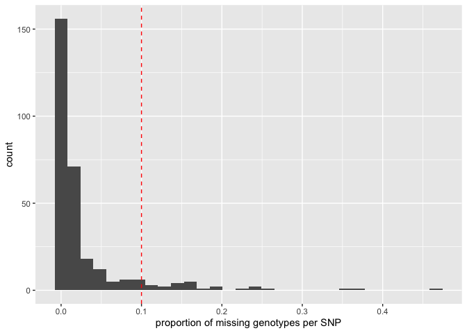
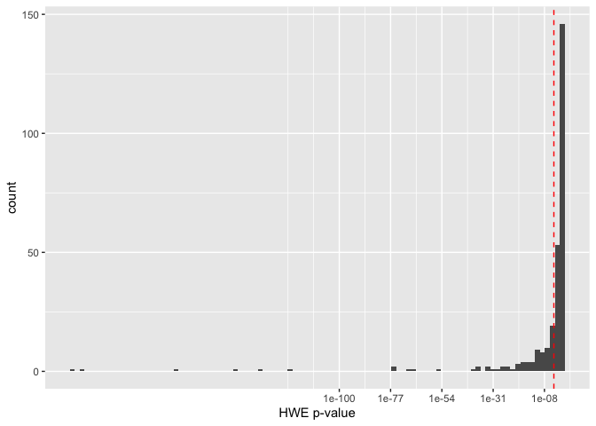
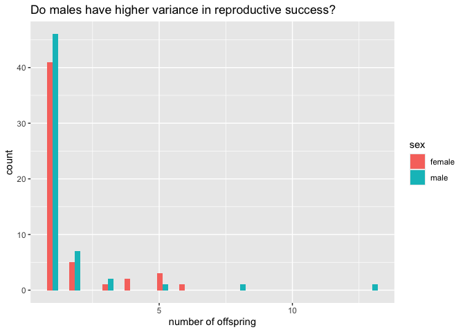
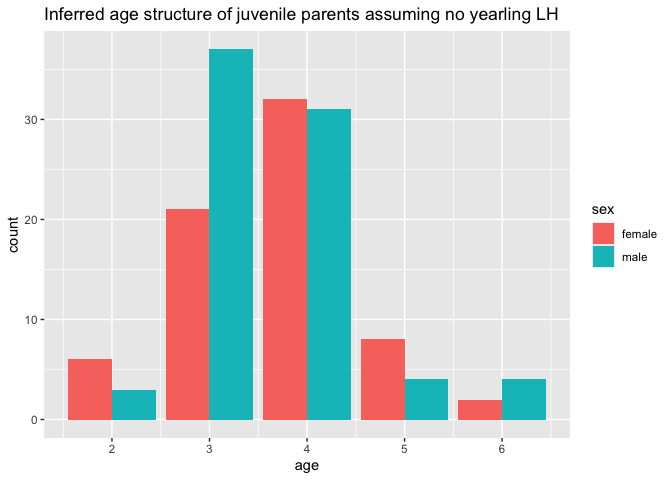

Exploratory data filtering and parentage analysis of 95 adult and 9,008
juvenile Nisqually River Chinook salmon
================

This is an exploratory analysis based on DFW’s data filtering criteria,
plus a few more filters. The ML parentage analysis uses `sequoia()`.
This is an unusual parentage analysis because of the many juveniles and
few adults.

First we load package libraries and set our working directory.

``` r
library(readxl)
library(tidyverse)
```

    ## ── Attaching core tidyverse packages ──────────────────────── tidyverse 2.0.0 ──
    ## ✔ dplyr     1.2.1     ✔ readr     2.2.0
    ## ✔ forcats   1.0.1     ✔ stringr   1.6.0
    ## ✔ ggplot2   4.0.3     ✔ tibble    3.3.1
    ## ✔ lubridate 1.9.5     ✔ tidyr     1.3.2
    ## ✔ purrr     1.2.2     
    ## ── Conflicts ────────────────────────────────────────── tidyverse_conflicts() ──
    ## ✖ dplyr::filter() masks stats::filter()
    ## ✖ dplyr::lag()    masks stats::lag()
    ## ℹ Use the conflicted package (<http://conflicted.r-lib.org/>) to force all conflicts to become errors

``` r
library(sequoia)
library(ASRgenomics)

setwd("~/Google Drive/My Drive/Nisqually/Nisqually/")
```

Adrian provided an MS Excel workbook containing genotypes and other
information. To import the genotypes, we first need to get the names of
the worksheets, as follows:

``` r
excel_sheets("../data-from-Adrian/Nisqually Chinook genotypes.xlsx")
```

    ##  [1] "pivot"                       "smolt trap sample genotypes"
    ##  [3] "95 random controls"          "Sheet1"                     
    ##  [5] "all loci"                    "culled"                     
    ##  [7] "genepop"                     "Sheet2"                     
    ##  [9] "genepop with assignments"    " genepop by origin"         
    ## [11] "UO gp"

Now we can import genotype data from 2 worksheets and join them
together.

``` r
dat <- 
  bind_rows(
    read_excel(
      path="../data-from-Adrian/Nisqually Chinook genotypes.xlsx", 
      sheet="smolt trap sample genotypes", 
      skip=1, 
      col_types="text"), 
    read_excel(
      path="../data-from-Adrian/Nisqually Chinook genotypes.xlsx", 
      sheet="95 random controls", 
      skip=1, 
      col_types="text")) |> 
  select(-random)
```

The column names include problematic characters such as whitespaces,
dashes, periods, etc. Lets cleanup the column names by replacing all of
those problematic characters with an underscore.

``` r
names(dat) <- 
  names(dat) |> 
  gsub(pattern="-", replacement="_") |> 
  gsub(pattern=" ", replacement="_") |> 
  gsub(pattern="'", replacement="_") |> 
  gsub(pattern=".", replacement="_", fixed=TRUE) |> 
  gsub(pattern="%", replacement="percent", fixed=TRUE)
```

Now lets import NEWHYBRIDS assignments that were provided by Adrian.
These include assignments for the juveniles only (all 95 adults are
Clear Creek HORs).

``` r
dat2 <-
  read_csv("../data-from-Adrian/newhybrids_assignments.csv")
```

    ## Rows: 9008 Columns: 2
    ## ── Column specification ────────────────────────────────────────────────────────
    ## Delimiter: ","
    ## chr (2): sample_name, newhybrids
    ## 
    ## ℹ Use `spec()` to retrieve the full column specification for this data.
    ## ℹ Specify the column types or set `show_col_types = FALSE` to quiet this message.

``` r
glimpse(dat2)
```

    ## Rows: 9,008
    ## Columns: 2
    ## $ sample_name <chr> "13QW0001_02", "13QW0001_03", "13QW0001_04", "13QW0001_05"…
    ## $ newhybrids  <chr> "F1Hybrid", "ClearCreek", "ClearCreek", "unassigned", "UO"…

Lets tabulate the juvenile NEWHYBRIDS assignments.

``` r
table(dat2$newhybrids)
```

    ## 
    ## ClearCreek   F1Hybrid unassigned         UO 
    ##       3082        772        997       4157

Lets construct a Life History (LH) table for the parentage analysis. For
juveniles, we set the `BirthYear` to the year before sample collection,
which is encoded as the first 2-digits of the DFW sample names. For
example, `BirthYear` of sample `13QW0001_02` would be `2012`. This
assumes no yearling LH.

``` r
lh <- 
  select(dat, Life_history, ID=USE_sample_name, Sex=Sex_ID, BirthYear=USE_sample_name) |>
  mutate(BirthYear=str_extract(BirthYear, "^\\d{2}") |> as.integer())

lh$BirthYear[1:9008] <- 
  lh$BirthYear[1:9008] + 1999

lh$BirthYear[9009:9103] <- 
  NA
```

For adults, we set the `BY.min` and `BY.max` to 6 and 2 years before the
sample collection year, respectively. For instance, `BY.min` and
`BY.max` of sample `18QN2832` would be `2012` and `2016`, respectively.

``` r
lh <- 
  mutate(lh, BY.min=NA, BY.max=NA)

lh$BY.min[9009:9103] <- 
  str_extract(string=lh$ID[9009:9103], pattern="^\\d{2}") |> 
  as.numeric() + 2000 - 6

lh$BY.max[9009:9103] <- 
  str_extract(string=lh$ID[9009:9103], pattern="^\\d{2}") |> 
  as.numeric() + 2000 - 2
```

Recode F,M as 1,2.

``` r
lh$Sex <- 
  gsub(pattern="F", replacement=1, lh$Sex) |>
  gsub(pattern="M", replacement=2) |>
  gsub(pattern="no data", replacement=NA) |>
  as.integer()

lh$BirthYear <- 
  as.integer(lh$BirthYear)

lh$BY.min <- 
  as.integer(lh$BY.min)

lh$BY.max <- 
  as.integer(lh$BY.max)

tail(lh)
```

    ## # A tibble: 6 × 6
    ##   Life_history ID         Sex BirthYear BY.min BY.max
    ##   <chr>        <chr>    <int>     <int>  <int>  <int>
    ## 1 adult        18QN2832     1        NA   2012   2016
    ## 2 adult        17RK3703     1        NA   2011   2015
    ## 3 adult        19QX2196     1        NA   2013   2017
    ## 4 adult        18QN3393     2        NA   2012   2016
    ## 5 adult        17RK3142     2        NA   2011   2015
    ## 6 adult        18QN2612     1        NA   2012   2016

DFW filters individuals with IFI scores less than 2.5. Lets see what
that looks like.

``` r
mutate(dat, IFI=as.double(IFI)) |> 
  ggplot(aes(x=IFI)) + 
  geom_histogram() + 
  geom_vline(xintercept=2.5, linetype="dashed", colour="red")
```

    ## `stat_bin()` using `bins = 30`. Pick better value `binwidth`.

    ## Warning: Removed 7 rows containing non-finite outside the scale range
    ## (`stat_bin()`).

<!-- -->

Lets go ahead and filter individuals with IFI scores less than 2.5.

``` r
gt <- 
  mutate(dat, IFI=as.double(IFI)) |>
  filter(IFI<=2.5) |>
  select(ID=USE_sample_name, 22:319)
```

Here we are prepending sample names with “s” or “a” to indicate smolt or
adult, and wrangling LH data.

``` r
gt$ID[1:8870] <- 
  paste0("s", gt$ID[1:8870])

gt$ID[8871:8965] <- 
  paste0("a", gt$ID[8871:8965])

lh$ID[1:9008] <- 
  paste0("s", lh$ID[1:9008])

lh$ID[9009:9103] <- 
  paste0("a", lh$ID[9009:9103])

lh <-
  filter(lh, ID %in% gt$ID)
```

Now we will filter exact duplicates.

``` r
dups <-
  column_to_rownames(gt, "ID")[duplicated(column_to_rownames(gt, "ID")), ] |>
  rownames_to_column("ID") |>
  as_tibble() |>
  select(ID)

gt <-
  filter(gt, !ID %in% dups$ID)

lh <-
  filter(lh, !ID %in% dups$ID)
```

For parentage analysis with `sequoia()`, we need to recode INDELs as
SNPs.

``` r
gt %>% 
  select(where(~any(grepl("-", .x, fixed=TRUE)))) %>% 
  glimpse()
```

    ## Rows: 8,951
    ## Columns: 8
    ## $ Ots_128757_61R  <chr> "A-", "--", "A-", "A-", "--", "--", "A-", "--", "AA", …
    ## $ Ots_GDH_81x     <chr> "C-", "--", "CC", "C-", "C-", "C-", "--", "C-", "C-", …
    ## $ Ots_Ots311_101x <chr> "A-", "AA", "A-", "AA", "AA", "AA", "AA", "AA", "AA", …
    ## $ Ots_RFC2_558    <chr> "A-", "A-", "A-", "A-", "AA", "AA", "A-", "AA", "AA", …
    ## $ Ots_U2305_63    <chr> "TT", "TT", "TT", "T-", "TT", "T-", "TT", "TT", "T-", …
    ## $ Ots_pigh_105    <chr> "A-", NA, "AA", "A-", NA, "AA", "A-", "A-", "AA", "AA"…
    ## $ Ots_u07_17_373  <chr> "A-", "AA", "AA", "A-", NA, "AA", "AA", "AA", "AA", "A…
    ## $ Ots_vatf_251    <chr> "--", "G-", "G-", "GG", "G-", "G-", "G-", "G-", "G-", …

``` r
gt$Ots_128757_61R <- 
  gsub(pattern="-", replacement="G", x=gt$Ots_128757_61R)

gt$Ots_GDH_81x <- 
  gsub(pattern="-", replacement="T", x=gt$Ots_GDH_81x)

gt$Ots_Ots311_101x <- 
  gsub(pattern="-", replacement="G", x=gt$Ots_Ots311_101x)

gt$Ots_RFC2_558 <- 
  gsub(pattern="-", replacement="G", x=gt$Ots_RFC2_558)

gt$Ots_U2305_63 <- 
  gsub(pattern="-", replacement="C", x=gt$Ots_U2305_63)

gt$Ots_pigh_105 <- 
  gsub(pattern="-", replacement="G", x=gt$Ots_pigh_105)

gt$Ots_u07_17_373 <- 
  gsub(pattern="-", replacement="G", x=gt$Ots_u07_17_373)

gt$Ots_vatf_251 <- 
  gsub(pattern="-", replacement="A", x=gt$Ots_vatf_251)
```

Now lets tabulate the proportion of missing genotypes per individual.

``` r
gt <-
  gt |>
  rowwise() |>
  mutate(perc=sum(is.na(c_across(2:299)))/298) |> 
  ungroup()
```

DFW filters individuals with less than 30% missing genotypes. Lets see
what that looks like.

``` r
ggplot(data=gt, mapping=aes(x=perc)) + 
  geom_histogram() + 
  geom_vline(xintercept=0.3, linetype="dashed", colour="red") +
  labs(x="proportion of missing genotypes per individual")
```

    ## `stat_bin()` using `bins = 30`. Pick better value `binwidth`.

<!-- -->

We’ll go ahead and filter individuals with ≤ 30% missing.

``` r
gt <- 
  filter(gt, perc<=0.3)

lh <- 
  filter(lh[-1], ID %in% pull(gt, ID))
```

DFW removes individuals with heterozygous genotypes called at less than
10% of genotyped loci. Lets see if any individuals meet this criteria.

``` r
# recode SNPs (e.g., AA, AG, GG) as numeric matrix (i.e., 0, 1, 2)
gm <- 
  snp.recode(
    M=as.matrix(column_to_rownames(gt[-300], var="ID")), 
    recoding="ATGCto012")
```

    ## Matrix M was recoded from bi-allelic nucleotide bases to numeric.

``` r
hets <- 
  rowSums(gm$Mrecode==1, na.rm=TRUE) / 
  (rowSums(gm$Mrecode==0, na.rm=TRUE) + rowSums(gm$Mrecode==2, na.rm=TRUE))
```

``` r
round(min(hets)*100, 1) 
```

    ## [1] 12.1

``` r
# The minimum heterozygous genotypes observed is 12.1%, so no filtering is needed.
```

DFW filters SNPs with less than 10% missing genotypes. Lets see what
that looks like.

``` r
snpstats <- 
  SnpStats(gm$Mrecode, Plot=FALSE)

as.data.frame(snpstats) |> 
  rownames_to_column("ID") |> 
  ggplot(mapping=aes(x=Mis)) + 
  geom_histogram() + 
  geom_vline(xintercept=0.1, linetype="dashed", colour="red") +
  labs(x="proportion of missing genotypes per SNP")
```

    ## `stat_bin()` using `bins = 30`. Pick better value `binwidth`.

<!-- -->

DFW doesn’t do any filtering based on conformance to Hardy-Weinberg
Equilibrium (HWE). I think severe violations of HWE are a good
indication of high genotyping error. Let’s consider filtering SNPs with
Bonferroni-corrected HWE p-value ≥ 0.05/n (n is number of HWE tests).

``` r
as.data.frame(snpstats) |> 
  rownames_to_column("ID") |> 
  ggplot(mapping=aes(x=HWE.p)) + 
  geom_histogram(bins=100) + 
  scale_x_log10() +
  geom_vline(xintercept=0.05/298, linetype="dashed", colour="red") +
  labs(x="HWE p-value")
```

    ## Warning in scale_x_log10(): log-10 transformation introduced infinite values.

    ## Warning: Removed 15 rows containing non-finite outside the scale range
    ## (`stat_bin()`).

<!-- -->

Lets filter SNPs with ≥ 90% genotypes and HWE.p ≥ 0.05/n. DFW doesn’t
filter SNPs based on Minor Allele Frequency (MAF), but I’m going to
remove SNPs with MAF \< 1%, because these SNPs are unlikely to be
informative for parentage analysis. Ideally, we would filter SNPs with
MAF ≥ 30% since Parent-Offspring (PO) pairs are evaluated with Opposing
Homozygosity (OH).

``` r
p90af99 <-
  as.data.frame(snpstats) |> rownames_to_column("ID") %>%
  filter(Mis<=0.1, HWE.p>=0.05/nrow(.), AF<=0.99) |>
  as_tibble()
```

A total of 180 SNPs remain after filtering. Most of these SNPs are
uninformative for parentage analysis because they have low MAFs (only 64
SNPs with MAF ≥ 30%, which is recommended MAF filtering for parentage
with `sequoia()`).

``` r
p90af99 %>% 
  print(n=nrow(.))
```

    ## # A tibble: 180 × 4
    ##     ID                       AF      Mis    HWE.p
    ##     <chr>                 <dbl>    <dbl>    <dbl>
    ##   1 Ots_101119_381_C_T    0.944 0.00235  0.937   
    ##   2 Ots_101770_82_G_T     0.949 0.00470  0.139   
    ##   3 Ots_102213_210_G_A    0.908 0.0361   0.997   
    ##   4 Ots_102801_308_C_A    0.944 0.00749  0.766   
    ##   5 Ots_102867_609_G_A    0.737 0.000447 0.845   
    ##   6 Ots_103041_52_G_A     0.704 0.00145  0.0324  
    ##   7 Ots_103122_180_C_T    0.765 0.00101  0.964   
    ##   8 Ots_104048_194_C_T    0.707 0.0232   0.0874  
    ##   9 Ots_104415_88_C_T     0.910 0.00380  0.694   
    ##  10 Ots_105105_613_C_G    0.618 0.0176   0.0216  
    ##  11 Ots_105132_200_T_G    0.979 0.000112 0.861   
    ##  12 Ots_105407_117_T_A    0.858 0.0124   0.912   
    ##  13 Ots_106313_729_A_G    0.969 0.00861  0.0392  
    ##  14 Ots_106419b_618_T_G   0.713 0.00705  0.00421 
    ##  15 Ots_106499_70_C_G     0.531 0.00235  0.991   
    ##  16 Ots_106747_239_A_C    0.805 0.00157  0.0970  
    ##  17 Ots_107074_284_T_A    0.818 0.00526  0.590   
    ##  18 Ots_107285_93_T_A     0.823 0.00213  0.414   
    ##  19 Ots_107607_315_C_A    0.779 0.00246  0.153   
    ##  20 Ots_107806_821_T_A    0.702 0.0363   0.0126  
    ##  21 Ots_108007_208_T_A    0.555 0.000671 0.348   
    ##  22 Ots_108390_329_C_G    0.770 0.00369  0.00291 
    ##  23 Ots_108820_336_A_G    0.875 0.00783  0.0129  
    ##  24 Ots_109525_816_C_T    0.981 0.00951  0.180   
    ##  25 Ots_109693_392_G_T    0.804 0.000336 0.931   
    ##  26 Ots_110064_383_C_T    0.596 0.000447 0.690   
    ##  27 Ots_110201_363_T_A    0.905 0.0136   0.998   
    ##  28 Ots_110381_164_A_G    0.895 0.00794  0.0886  
    ##  29 Ots_110495_380_G_C    0.532 0.0432   0.193   
    ##  30 Ots_110551_64_C_A     0.708 0.00951  0.390   
    ##  31 Ots_111084b_619_C_A   0.695 0.0255   0.433   
    ##  32 Ots_111681_657_T_G    0.562 0.0330   0.00176 
    ##  33 Ots_112419_131_A_T    0.558 0.0102   0.123   
    ##  34 Ots_112820_284_C_T    0.550 0.00850  0.181   
    ##  35 Ots_112876_371_C_A    0.588 0.00347  0.991   
    ##  36 Ots_113242_216_T_C    0.506 0.00291  0.455   
    ##  37 Ots_113457_40R_T_C    0.681 0.0213   0.299   
    ##  38 Ots_115987_325_T_G    0.700 0.00626  0.00188 
    ##  39 Ots_117242_136_A_G    0.693 0.00336  0.00181 
    ##  40 Ots_117259_271_T_G    0.725 0.00414  0.999   
    ##  41 Ots_117432_409_G_A    0.830 0.000336 0.741   
    ##  42 Ots_118175_479_C_T    0.703 0.00280  0.0168  
    ##  43 Ots_118205_61_C_T     0.803 0.00324  0.999   
    ##  44 Ots_120950_417_A_T    0.632 0.00447  0.999   
    ##  45 Ots_122414_56_C_T     0.690 0.00157  0.0520  
    ##  46 Ots_123048_521_A_C    0.661 0.00134  0.00793 
    ##  47 Ots_123921_111_G_A    0.965 0.0155   1.000   
    ##  48 Ots_124774_477_C_T    0.521 0.0252   0.532   
    ##  49 Ots_127236_62_A_T     0.605 0.0195   0.0234  
    ##  50 Ots_128302_57_T_C     0.922 0.0318   0.464   
    ##  51 Ots_128693_461_T_C    0.566 0.00268  0.699   
    ##  52 Ots_128757_61R_G_A    0.654 0.00190  0.916   
    ##  53 Ots_129144_472_A_C    0.796 0.00414  0.728   
    ##  54 Ots_129458_451_C_T    0.761 0.00246  0.000719
    ##  55 Ots_130720_99_A_G     0.620 0.00145  0.423   
    ##  56 Ots_131460_584_T_C    0.502 0.00358  0.00171 
    ##  57 Ots_131906_141_A_T    0.593 0.00347  0.438   
    ##  58 Ots_94857_232R_T_C    0.656 0.000783 0.725   
    ##  59 Ots_94903_99R_G_T     0.743 0.00526  0.491   
    ##  60 Ots_96500_180_G_T     0.726 0.0223   0.00201 
    ##  61 Ots_96899_357R_T_A    0.984 0.00615  0.145   
    ##  62 Ots_97077_179R_T_G    0.733 0.00414  0.610   
    ##  63 Ots_97660_56_T_A      0.841 0.0572   0.159   
    ##  64 Ots_99550_204_C_T     0.812 0.00280  0.0917  
    ##  65 Ots_AsnRS_60_C_T      0.677 0.0218   0.180   
    ##  66 Ots_BMP2_SNP1_C_T     0.886 0.00962  0.0322  
    ##  67 Ots_CCR7_T_C          0.563 0.0426   0.0398  
    ##  68 Ots_CD59_2_G_A        0.637 0.0214   0.644   
    ##  69 Ots_Cath_D141_C_T     0.981 0.00816  0.323   
    ##  70 Ots_DDX5_171_C_T      0.856 0.000559 0.285   
    ##  71 Ots_E2_275_G_A        0.772 0.00559  0.417   
    ##  72 Ots_EP_529_G_A        0.934 0.000783 0.515   
    ##  73 Ots_EndoRB1_486_G_A   0.706 0.00201  0.974   
    ##  74 Ots_Est740_T_C        0.746 0.0104   0.00601 
    ##  75 Ots_FARSLA_220_A_G    0.959 0.00313  0.200   
    ##  76 Ots_FGF6A_G_T         0.958 0.0553   0.707   
    ##  77 Ots_FGF6B_1_C_A       0.620 0.0115   0.186   
    ##  78 Ots_GCSH_C_T          0.903 0.00324  0.00500 
    ##  79 Ots_GDH_81x_C_T       0.588 0.00302  0.0322  
    ##  80 Ots_GH2_A_T           0.970 0.00324  0.00707 
    ##  81 Ots_GPH_318_C_T       0.966 0.00257  0.608   
    ##  82 Ots_GnRH_271_C_T      0.933 0.0292   0.0767  
    ##  83 Ots_HMGB1_73_G_T      0.621 0.00850  0.138   
    ##  84 Ots_HSP90B_100_T_C    0.931 0.000112 0.00508 
    ##  85 Ots_Hsp90a_G_C        0.690 0.0176   0.149   
    ##  86 Ots_IL8R_C8_C_T       0.891 0.00738  0.734   
    ##  87 Ots_OTSMTA_SNP1_T_C   0.836 0.00828  0.0233  
    ##  88 Ots_OTSTF1_SNP1_T_G   0.909 0.00805  0.260   
    ##  89 Ots_Ots311_101x_A_G   0.844 0.00145  0.953   
    ##  90 Ots_P450_A_T          0.986 0.0512   0.146   
    ##  91 Ots_P53_G_A           0.757 0.00548  0.616   
    ##  92 Ots_PEMT_T_C          0.501 0.00895  0.0338  
    ##  93 Ots_PGK_54_A_T        0.576 0.0133   0.464   
    ##  94 Ots_Prl2_A_G          0.657 0.00514  0.000908
    ##  95 Ots_RAD4543_52_T_C    0.959 0.000895 0.439   
    ##  96 Ots_RAG3_C_T          0.660 0.0209   0.328   
    ##  97 Ots_RFC2_558_A_G      0.601 0.00660  0.524   
    ##  98 Ots_S7_1_T_C          0.645 0.0186   0.863   
    ##  99 Ots_SClkF2R2_135_A_T  0.612 0.00157  0.349   
    ## 100 Ots_SL_G_A            0.717 0.00414  0.0604  
    ## 101 Ots_SWS1op_182_A_T    0.687 0.0183   0.00102 
    ## 102 Ots_TCTA_58_C_T       0.775 0.00190  0.739   
    ## 103 Ots_TGFB_C_T          0.641 0.00828  0.448   
    ## 104 Ots_TNF_C_T           0.976 0.00213  0.677   
    ## 105 Ots_U212_158_G_A      0.874 0.0138   0.173   
    ## 106 Ots_U2362_227_T_A     0.820 0.000336 0.0770  
    ## 107 Ots_U2362_330_A_G     0.970 0.000336 0.512   
    ## 108 Ots_U2446_123_C_A     0.701 0.0162   0.346   
    ## 109 Ots_U2567_104_G_A     0.794 0.00302  0.0354  
    ## 110 Ots_ZR_575_G_A        0.956 0.0900   0.363   
    ## 111 Ots_aspat_196_G_C     0.877 0.00492  0.669   
    ## 112 Ots_brp16_64_C_T      0.660 0.00101  0.500   
    ## 113 Ots_cgo24_22_C_T      0.649 0.00336  0.694   
    ## 114 Ots_cox1_241_T_C      0.726 0.00380  0.00388 
    ## 115 Ots_crRAD10447_25_C_T 0.988 0.0917   0.0214  
    ## 116 Ots_crRAD11620_55_C_T 0.596 0.00570  0.00262 
    ## 117 Ots_crRAD12037_39_G_A 0.565 0.0147   0.629   
    ## 118 Ots_crRAD12711_37_C_T 0.967 0.00134  0.311   
    ## 119 Ots_crRAD13725_51_A_C 0.509 0.00302  0.716   
    ## 120 Ots_crRAD16540_50_C_T 0.553 0.00347  0.000178
    ## 121 Ots_crRAD18289_33_C_T 0.980 0.00526  0.776   
    ## 122 Ots_crRAD18492_65_C_T 0.926 0.0349   0.816   
    ## 123 Ots_crRAD18937_60_G_A 0.756 0.0189   0.00211 
    ## 124 Ots_crRAD20262_46_G_A 0.581 0.00179  0.415   
    ## 125 Ots_crRAD20887_70_A_G 0.664 0.00190  0.997   
    ## 126 Ots_crRAD21115_24_C_T 0.779 0.0174   1.000   
    ## 127 Ots_crRAD25367_50_G_T 0.513 0.00805  0.997   
    ## 128 Ots_crRAD26165_69_T_C 0.949 0.00984  0.450   
    ## 129 Ots_crRAD26541_47_G_A 0.936 0.0459   0.0618  
    ## 130 Ots_crRAD27164_55_A_T 0.930 0.00123  0.665   
    ## 131 Ots_crRAD2806_42_C_A  0.774 0.00928  0.0107  
    ## 132 Ots_crRAD28677_65_C_T 0.548 0.0495   0.0113  
    ## 133 Ots_crRAD33491_71_T_C 0.539 0.00470  0.536   
    ## 134 Ots_crRAD36152_44_C_T 0.972 0.0823   0.177   
    ## 135 Ots_crRAD44588_67_C_T 0.602 0.00403  0.997   
    ## 136 Ots_crRAD46081_56_C_T 0.853 0.00861  0.999   
    ## 137 Ots_crRAD55400_59_C_T 0.882 0.00816  0.554   
    ## 138 Ots_crRAD57376_68_C_T 0.952 0.0244   0.992   
    ## 139 Ots_crRAD57520_66_G_T 0.647 0.000783 0.997   
    ## 140 Ots_crRAD60614_46_G_T 0.968 0.00224  0.418   
    ## 141 Ots_crRAD60620_51_A_G 0.814 0.00157  0.00481 
    ## 142 Ots_crRAD61523_71_A_G 0.877 0.00593  0.00106 
    ## 143 Ots_crRAD66330_60_G_T 0.675 0.0227   0.000414
    ## 144 Ots_crRAD69327_53_G_T 0.720 0.00280  0.359   
    ## 145 Ots_crRAD73823_60_A_T 0.509 0.00268  0.0572  
    ## 146 Ots_crRAD74766_28_G_A 0.753 0.00280  0.903   
    ## 147 Ots_crRAD78968_46_C_T 0.770 0.0110   0.539   
    ## 148 Ots_crRAD92420_25_G_T 0.895 0.00783  0.155   
    ## 149 Ots_crRAD9615_69_T_C  0.874 0.000559 0.348   
    ## 150 Ots_hsc71_3__488_C_T  0.827 0.00928  0.0579  
    ## 151 Ots_hsp27b_150_G_A    0.662 0.00336  0.631   
    ## 152 Ots_mybp_85_T_C       0.633 0.0228   0.140   
    ## 153 Ots_myo1a_384_A_C     0.792 0.00201  0.985   
    ## 154 Ots_myoD_364_G_T      0.508 0.0192   0.169   
    ## 155 Ots_nelfd_163_G_A     0.566 0.0103   0.0185  
    ## 156 Ots_nramp_321_A_G     0.777 0.00436  0.959   
    ## 157 Ots_ntl_255_T_A       0.833 0.00268  0.995   
    ## 158 Ots_parp3_286_A_G     0.809 0.00503  0.650   
    ## 159 Ots_pop5_96_T_C       0.934 0.00123  0.829   
    ## 160 Ots_redd1_187_A_G     0.989 0        0.594   
    ## 161 Ots_stk6_516_A_C      0.981 0        0.258   
    ## 162 Ots_tpx2_125_C_T      0.883 0.00123  0.830   
    ## 163 Ots_trnau1ap_86_G_T   0.932 0.00391  0.607   
    ## 164 Ots_txnip_321_T_C     0.968 0.00336  0.399   
    ## 165 Ots_u07_17_135_G_A    0.985 0.00291  0.00159 
    ## 166 Ots_u07_17_373_A_G    0.911 0.0190   0.223   
    ## 167 Ots_u07_18_378_A_T    0.819 0.00570  0.0162  
    ## 168 Ots_u07_20_332_C_A    0.967 0.0363   0.0418  
    ## 169 Ots_u07_25_325_C_T    0.957 0.0831   0.415   
    ## 170 Ots_u07_49_290_A_G    0.700 0.00246  0.668   
    ## 171 Ots_u07_53_133_T_C    0.610 0.0238   0.171   
    ## 172 Ots_u1002_75_T_C      0.716 0.000559 0.00339 
    ## 173 Ots_u1007_124_A_G     0.848 0.00145  0.532   
    ## 174 Ots_u211_85_T_C       0.632 0.00526  0.551   
    ## 175 Ots_u4_92_T_C         0.542 0.00492  0.785   
    ## 176 Ots_unk1104_38_C_T    0.534 0.00157  0.771   
    ## 177 Ots_unk1832_39_C_T    0.769 0.00112  0.0216  
    ## 178 Ots_unk526_G_A        0.791 0.000671 0.00365 
    ## 179 Ots_unk7936_50_G_C    0.728 0.0218   0.344   
    ## 180 Ots_unk9480_51_C_G    0.772 0.000671 0.835

Now we’re going to check for duplicates and filter the duplicate samples
with more genotypes. We do this 2x to remove all potential duplicates.

``` r
gm75 <- 
  snp.recode(
    M=as.matrix(
      column_to_rownames(
        select(gt[-300], c("ID", str_remove(string=p90af99$ID, pattern="[A-Z_0]{4}$"))), 
        var="ID")), 
    recoding="ATGCto012")
```

    ## Matrix M was recoded from bi-allelic nucleotide bases to numeric.

``` r
gm75 <- 
  CheckGeno(gm75$Mrecode)
```

    ## ✔ Genotype matrix looks OK! There are  8941  individuals and  180  SNPs.

``` r
dup1 <- 
  sequoia(
    GenoM=gm75, 
    LifeHistData=as.data.frame(lh), 
    Module="dup", 
    quiet="verbose", 
    Plot=FALSE)
```

    ## ℹ Checking input data ...

    ## ✔ Genotype matrix looks OK! There are  8941  individuals and  180  SNPs.

    ## 

    ## ── Among genotyped individuals: ___

    ## ℹ There are 4449 females, 4437 males, 55 of unknown sex, and 0 hermaphrodites.

    ## ℹ Exact birth years are from 2012 to 2019

    ## ℹ Birth year min/max are from 2011 to 2017

    ## ___

    ## ℹ Calling `MakeAgePrior()` ...

    ## 
    ## ~~~ Duplicate check ~~~

    ##  0   10  20  30  40  50  60  70  80  90  100% 
    ##  |   |   |   |   |   |   |   |   |   |   |
    ##   ****************************************

    ## ℹ Found 100 likely duplicate genotypes,please double check and consider
    ## removing

``` r
# filter duplicates with most calls
dup1cut <- 
  bind_cols(
    filter(gt, ID %in% dup1$DupGenotype$ID1) |> select(ID1=ID, perc1=perc), 
    filter(gt, ID %in% dup1$DupGenotype$ID2) |> select(ID2=ID, perc2=perc)) %>% 
  mutate(ID=if_else(condition=perc1<=perc2, true=ID2, false=ID1))

print(dup1cut)
```

    ## # A tibble: 100 × 5
    ##    ID1           perc1 ID2            perc2 ID          
    ##    <chr>         <dbl> <chr>          <dbl> <chr>       
    ##  1 s13QW0001_25 0.0134 s13QW0001_29 0.0403  s13QW0001_29
    ##  2 s13QW0003_14 0.0134 s13QW0003_33 0.0369  s13QW0003_33
    ##  3 s13QW0005_03 0.0235 s13QW0005_19 0.0168  s13QW0005_03
    ##  4 s13QW0005_04 0.107  s13QW0005_31 0.00671 s13QW0005_04
    ##  5 s13QW0005_07 0.0101 s13QW0005_32 0.0201  s13QW0005_32
    ##  6 s13QW0005_10 0.0268 s13QW0005_37 0.0235  s13QW0005_10
    ##  7 s13QW0005_13 0.0403 s13QW0005_38 0.00671 s13QW0005_13
    ##  8 s13QW0005_27 0.221  s13QW0005_39 0.0134  s13QW0005_27
    ##  9 s13QW0005_34 0.0134 s13QW0005_41 0.0403  s13QW0005_41
    ## 10 s13QW0005_36 0.0101 s13QW0005_43 0.0134  s13QW0005_43
    ## # ℹ 90 more rows

``` r
gm75c <- 
  snp.recode(
    M=as.matrix(
      column_to_rownames(
        select(
          gt[-300], 
          c("ID", str_remove(string=p90af99$ID, pattern="[A-Z_0]{4}$"))) |> filter(!ID %in% pull(dup1cut, ID)), 
        var="ID")), 
    recoding="ATGCto012")
```

    ## Matrix M was recoded from bi-allelic nucleotide bases to numeric.

``` r
lhc <- 
  filter(lh, ID %in% rownames(gm75c$Mrecode))

gm75c <- 
  CheckGeno(gm75c$Mrecode)
```

    ## ✔ Genotype matrix looks OK! There are  8841  individuals and  180  SNPs.

``` r
dim(lhc)
```

    ## [1] 8841    5

``` r
# check for duplicates again
dup2 <- 
  sequoia(
    GenoM=gm75c, 
    LifeHistData=as.data.frame(lhc), 
    Module="dup",
    quiet="verbose", 
    Plot=FALSE)
```

    ## ℹ Checking input data ...

    ## ✔ Genotype matrix looks OK! There are  8841  individuals and  180  SNPs.

    ## 

    ## ── Among genotyped individuals: ___

    ## ℹ There are 4402 females, 4384 males, 55 of unknown sex, and 0 hermaphrodites.

    ## ℹ Exact birth years are from 2012 to 2019

    ## ℹ Birth year min/max are from 2011 to 2017

    ## ___

    ## ℹ Calling `MakeAgePrior()` ...

    ## 
    ## ~~~ Duplicate check ~~~

    ##  0   10  20  30  40  50  60  70  80  90  100% 
    ##  |   |   |   |   |   |   |   |   |   |   |
    ##   ****************************************

    ## ℹ Found 10 likely duplicate genotypes,please double check and consider removing

``` r
dup2cut <- 
  bind_cols(
    filter(gt, ID %in% dup2$DupGenotype$ID1) |> select(ID1=ID, perc1=perc), 
    filter(gt, ID %in% dup2$DupGenotype$ID2) |> select(ID2=ID, perc2=perc)) %>% 
  mutate(ID=if_else(condition=perc1<=perc2, true=ID2, false=ID1))
```

Okay, now we’re ready to infer parentage. We include min (2) and max (6)
age constraints for parents (the default would be 1 and 9).

``` r
par1 <- 
  sequoia(
    GenoM=gm75c[rownames(gm75c)[!rownames(gm75c) %in% dup2cut$ID], ], 
    LifeHistData=as.data.frame(lhc) |> filter(!ID %in% dup2cut$ID), 
    Module="par",
    quiet="verbose", 
    args.AP=list(MinAgeParent=2, MaxAgeParent=6),
    Plot=FALSE)
```

    ## ℹ Checking input data ...

    ## ✔ Genotype matrix looks OK! There are  8831  individuals and  180  SNPs.

    ## 

    ## ── Among genotyped individuals: ___

    ## ℹ There are 4401 females, 4375 males, 55 of unknown sex, and 0 hermaphrodites.

    ## ℹ Exact birth years are from 2012 to 2019

    ## ℹ Birth year min/max are from 2011 to 2017

    ## ___

    ## ℹ Calling `MakeAgePrior()` ...

    ## ℹ Ageprior: Flat 0/1, overlapping generations, MaxAgeParent = 6,6

    ## 
    ## ~~~ Duplicate check ~~~

    ##  0   10  20  30  40  50  60  70  80  90  100% 
    ##  |   |   |   |   |   |   |   |   |   |   |
    ##   ****************************************

    ## ✔ No potential duplicates found

    ## 
    ## ~~~ Parentage assignment ~~~

    ## 
    ##  Time    |  R |  Step      |  Progress  | Dams  | Sires |  GPs  |   Total LL 
    ## -------- | -- | ---------- | ---------- | ----- | ----- | ----- | ----------
    ## 09:18:04 |  0 | count OH   |            | 
    ## 09:18:04 |  0 | initial    |            |     0 |     0 |     0 |  -505624.0 
    ## 09:18:04 |  1 | parents    | .......... |    81 |    91 |     0 |  -504261.2 
    ## 09:18:18 |  2 | parents    | .......... |    83 |    92 |     0 |  -504256.0 
    ## 09:18:31 |  3 | parents    | .......... |    83 |    92 |     0 |  -504256.0 
    ## 09:18:45 | 99 | est byears | .......... |

    ## ✔ assigned 83 dams and 92 sires to 8831 individuals

    ## ℹ You can use `SummarySeq()` for pedigree details, `CalcParentProbs()` for
    ## assignment probabilities, and `EstConf()` for confidence estimates

    ## ℹ Run `GetMaybeRel()` conditional on this pedigree to check for any
    ## non-assigned parents

Lets look at the parentage results. `OHdam`, `OHsire` show the Opposing
Homozygosity (OH) counts for PO pairs, and `MEpair` is the number of
Mendelian Errors (ME) for PO trios. OH and ME other than 0 arise from
genotyping errors, so ideally these would all be zero.

``` r
filter(par1$PedigreePar, !is.na(dam) | !is.na(sire)) |> 
  as_tibble() |> 
  select(-LLRdam, -LLRsire, -LLRpair) %>% 
  print(n=nrow(.))
```

    ## # A tibble: 173 × 6
    ##     id            dam           sire          OHdam OHsire MEpair
    ##     <chr>         <chr>         <chr>         <int>  <int>  <int>
    ##   1 s15JS0034_005 <NA>          s13QW0004_24     NA      0     NA
    ##   2 s18GX0010_1   <NA>          s14TZ0008_111    NA      0     NA
    ##   3 s18GX0039_1   s15JS0001_005 <NA>              0     NA     NA
    ##   4 s18GX0045_7   s13QW0016_080 <NA>              0     NA     NA
    ##   5 s18GX0054_3   <NA>          a17RK2386        NA      0     NA
    ##   6 s18GX0060_4   <NA>          a17RK2386        NA      0     NA
    ##   7 s18GX0067_5   a17RK3793     <NA>              0     NA     NA
    ##   8 s18GX0067_8   a17RK2671     <NA>              0     NA     NA
    ##   9 s18GX0068_5   a17RK3793     <NA>              0     NA     NA
    ##  10 s18GX0070_6   <NA>          s15JS0011_010    NA      1     NA
    ##  11 s18GX0075_7   a17RK3793     <NA>              0     NA     NA
    ##  12 s18GX0077_7   s14TZ0003_003 <NA>              0     NA     NA
    ##  13 s18GX0078_2   <NA>          s14TZ0005_045    NA      0     NA
    ##  14 s18GX0078_7   a17RK3793     <NA>              0     NA     NA
    ##  15 s18GX0079_9   s14TZ0003_003 <NA>              0     NA     NA
    ##  16 s18GX0083_8   s14TZ0003_003 <NA>              0     NA     NA
    ##  17 s18GX0089_2   <NA>          s15JS0036_011    NA      0     NA
    ##  18 s18GX0093_3   s15JS0201_020 <NA>              0     NA     NA
    ##  19 s18GX0095_1   <NA>          s15JS0020_009    NA      0     NA
    ##  20 s18GX0097_6   s14TZ0003_003 <NA>              0     NA     NA
    ##  21 s18GX0114_5   s13QW0001_16  <NA>              1     NA     NA
    ##  22 s18GX0122_4   s14TZ0006_062 <NA>              0     NA     NA
    ##  23 s18GX0123_7   <NA>          s14TZ0007_131    NA      1     NA
    ##  24 s18GX0133_7   a17RK2082     <NA>              0     NA     NA
    ##  25 s18GX0138_2   <NA>          s15JS0025_014    NA      0     NA
    ##  26 s18GX0141_2   <NA>          s14TZ0004_124    NA      0     NA
    ##  27 s18GX0145_6   <NA>          s15JS0011_004    NA      1     NA
    ##  28 s18GX0146_3   <NA>          s15JS0020_009    NA      0     NA
    ##  29 s18GX0148_2   s14TZ0001_092 <NA>              0     NA     NA
    ##  30 s18GX0151_4   s15JS0002_001 <NA>              0     NA     NA
    ##  31 s18GX0153_3   s13QW0009_113 <NA>              0     NA     NA
    ##  32 s18GX0154_4   a17RK3793     <NA>              0     NA     NA
    ##  33 s18GX0157_1   <NA>          s15JS0036_011    NA      0     NA
    ##  34 s18GX0158_3   <NA>          a17RK3106        NA      0     NA
    ##  35 s18GX0160_5   <NA>          s15JS0020_009    NA      0     NA
    ##  36 s18GX0161_1   s15JS0018_008 <NA>              0     NA     NA
    ##  37 s18GX0163_2   <NA>          a17RK3038        NA      0     NA
    ##  38 s18GX0163_4   <NA>          a17RK3106        NA      0     NA
    ##  39 s18GX0167_9   s15JS0028_011 <NA>              0     NA     NA
    ##  40 s18GX0170_7   <NA>          s15JS0201_011    NA      0     NA
    ##  41 s18GX0178_4   s15JS0050_019 <NA>              0     NA     NA
    ##  42 s18GX0181_8   s14TZ0008_092 <NA>              0     NA     NA
    ##  43 s18GX0185_7   <NA>          s15JS0036_011    NA      0     NA
    ##  44 s18GX0186_1   <NA>          s15JS0002_015    NA      0     NA
    ##  45 s18GX0190_1   <NA>          s15JS0010_016    NA      0     NA
    ##  46 s18GX0192_5   <NA>          a17RK2020        NA      0     NA
    ##  47 s18GX0193_3   s14TZ0008_034 <NA>              0     NA     NA
    ##  48 s18GX0196_9   s15JS0032_017 <NA>              0     NA     NA
    ##  49 s18GX0199_9   s15JS0041_017 <NA>              1     NA     NA
    ##  50 s18GX0203_6   <NA>          s15JS0017_018    NA      1     NA
    ##  51 s18GX0206_1   <NA>          s15JS0020_009    NA      0     NA
    ##  52 s18GX0207_2   <NA>          a17RK2020        NA      0     NA
    ##  53 s18GX0208_4   <NA>          s15JS0020_009    NA      0     NA
    ##  54 s18GX0217_2   s15JS0201_020 <NA>              0     NA     NA
    ##  55 s18GX0217_5   <NA>          s15JS0036_011    NA      0     NA
    ##  56 s18GX0217_8   <NA>          s15JS0036_011    NA      0     NA
    ##  57 s18GX0228_8   <NA>          s15JS0036_011    NA      0     NA
    ##  58 s18GX0231_1   <NA>          s14TZ0011_066    NA      0     NA
    ##  59 s18GX0235_7   s15JS0002_001 s15JS0036_011     0      0      0
    ##  60 s18GX0239_5   s15JS0002_001 <NA>              0     NA     NA
    ##  61 s18GX0240_6   s15JS0201_020 <NA>              0     NA     NA
    ##  62 s18GX0241_4   <NA>          s15JS0045_005    NA      0     NA
    ##  63 s18GX0243_3   s15JS0033_012 <NA>              0     NA     NA
    ##  64 s18GX0243_4   <NA>          s15JS0036_011    NA      0     NA
    ##  65 s18GX0244_1   <NA>          s14TZ0011_079    NA      0     NA
    ##  66 s18GX0246_2   s15JS0002_001 s15JS0036_011     0      0      0
    ##  67 s18GX0247_3   <NA>          s15JS0060_008    NA      0     NA
    ##  68 s18GX0247_4   <NA>          s14TZ0009_018    NA      0     NA
    ##  69 s18GX0248_1   s15JS0002_001 <NA>              0     NA     NA
    ##  70 s18GX0254_8   s15JS0201_020 <NA>              0     NA     NA
    ##  71 s18GX0261_2   <NA>          s15JS0036_011    NA      0     NA
    ##  72 s18GX0275_7   <NA>          s15JS0032_016    NA      0     NA
    ##  73 s18GX0276_7   s14TZ0007_025 <NA>              0     NA     NA
    ##  74 s18GX0277_4   <NA>          a17RK2020        NA      0     NA
    ##  75 s18GX0278_2   s15JS0008_006 <NA>              0     NA     NA
    ##  76 s18GX0283_1   <NA>          s15JS0044_012    NA      0     NA
    ##  77 s18GX0283_7   s15JS0018_008 <NA>              0     NA     NA
    ##  78 s18GX0283_8   <NA>          s15JS0040_009    NA      0     NA
    ##  79 s18GX0285_2   s15JS0031_009 <NA>              1     NA     NA
    ##  80 s18GX0288_7   s15JS0045_001 <NA>              0     NA     NA
    ##  81 s18GX0291_8   <NA>          s15JS0061_005    NA      0     NA
    ##  82 s18GX0294_4   <NA>          s15JS0036_011    NA      0     NA
    ##  83 s18GX0298_1   <NA>          s15JS0036_011    NA      0     NA
    ##  84 s18GX0298_5   s15JS0036_007 <NA>              1     NA     NA
    ##  85 s18GX0299_3   <NA>          s15JS0032_016    NA      0     NA
    ##  86 s18GX0305_6   <NA>          s15JS0046_011    NA      0     NA
    ##  87 s18GX0307_1   <NA>          s15JS0032_016    NA      0     NA
    ##  88 s18GX0308_3   <NA>          s15JS0038_010    NA      0     NA
    ##  89 s18GX0309_6   <NA>          s15JS0036_011    NA      0     NA
    ##  90 s18GX0309_7   <NA>          s15JS0056_013    NA      0     NA
    ##  91 s18GX0310_4   <NA>          s15JS0028_006    NA      1     NA
    ##  92 s19DY0103     <NA>          s15JS0063_007    NA      0     NA
    ##  93 s19DY0182     a18QN3058     <NA>              0     NA     NA
    ##  94 s19DY0211     <NA>          s15JS0032_019    NA      1     NA
    ##  95 s19DY0232     <NA>          a19QX2725        NA      0     NA
    ##  96 s19DY0274     s13QW0010_042 <NA>              1     NA     NA
    ##  97 s19DY0304     a18QN3745     <NA>              0     NA     NA
    ##  98 s19DY0366     s15JS0010_017 <NA>              0     NA     NA
    ##  99 s19DY0390     <NA>          a18QN3757        NA      0     NA
    ## 100 s19DY0472     a18QN3745     <NA>              0     NA     NA
    ## 101 s19DY0494     s15JS0009_015 <NA>              1     NA     NA
    ## 102 s19DY0506     s15JS0001_005 <NA>              1     NA     NA
    ## 103 s19DY0651     <NA>          s15JS0057_009    NA      0     NA
    ## 104 s19DY0704     s15JS0016_011 <NA>              0     NA     NA
    ## 105 s19DY0769     s15JS0005_014 <NA>              1     NA     NA
    ## 106 s19DY0781     s15JS0010_017 <NA>              0     NA     NA
    ## 107 s19DY0784     <NA>          s15JS0201_011    NA      0     NA
    ## 108 s19DY0793     <NA>          s15JS0201_002    NA      0     NA
    ## 109 s19DY0840     a18QN2710     <NA>              0     NA     NA
    ## 110 s19DY0870     s15JS0016_011 <NA>              0     NA     NA
    ## 111 s19DY0871     <NA>          s15JS0002_009    NA      0     NA
    ## 112 s19DY0883     s15JS0010_017 <NA>              0     NA     NA
    ## 113 s19DY0929     s15JS0010_017 <NA>              0     NA     NA
    ## 114 s19DY0970     <NA>          s15JS0202_019    NA      0     NA
    ## 115 s19DY0979     s15JS0010_017 <NA>              0     NA     NA
    ## 116 s19DY1012     s15JS0031_017 <NA>              0     NA     NA
    ## 117 s19DY1015     s15JS0050_019 <NA>              0     NA     NA
    ## 118 s19DY1028     s15JS0016_011 <NA>              0     NA     NA
    ## 119 s19DY1029     <NA>          s15JS0047_003    NA      1     NA
    ## 120 s19DY1030     <NA>          s15JS0036_010    NA      0     NA
    ## 121 s19DY1061     s14TZ0002_100 <NA>              1     NA     NA
    ## 122 s19DY1065     <NA>          a18QN3757        NA      0     NA
    ## 123 s19DY1069     <NA>          s15JS0030_004    NA      0     NA
    ## 124 s19DY1077     s15JS0064_011 <NA>              1     NA     NA
    ## 125 s19DY1102     <NA>          s15JS0030_004    NA      0     NA
    ## 126 s19DY1134     s15JS0031_017 <NA>              0     NA     NA
    ## 127 s19DY1151     s15JS0016_011 <NA>              0     NA     NA
    ## 128 s19DY1170     <NA>          s15JS0030_004    NA      0     NA
    ## 129 s19DY1175     s15JS0016_011 <NA>              0     NA     NA
    ## 130 s19DY1190     s15JS0016_011 <NA>              0     NA     NA
    ## 131 s19DY1212     <NA>          s15JS0030_004    NA      0     NA
    ## 132 s19DY1221     <NA>          s15JS0047_011    NA      0     NA
    ## 133 s19DY1222     s13QW0004_23  <NA>              0     NA     NA
    ## 134 s19DY1238     <NA>          s15JS0059_006    NA      1     NA
    ## 135 s19DY1293     s15JS0031_006 <NA>              0     NA     NA
    ## 136 s19DY1299     <NA>          s15JS0050_002    NA      0     NA
    ## 137 s19DY1304     <NA>          s15JS0030_004    NA      0     NA
    ## 138 s19DY1333     <NA>          s15JS0053_005    NA      0     NA
    ## 139 s19DY1339     s15JS0033_006 <NA>              1     NA     NA
    ## 140 s19DY1344     <NA>          s15JS0030_004    NA      0     NA
    ## 141 s19DY1351     s15JS0061_006 <NA>              0     NA     NA
    ## 142 s19DY1357     <NA>          s15JS0030_004    NA      0     NA
    ## 143 s19DY1391     <NA>          s15JS0058_013    NA      1     NA
    ## 144 s19DY1409     s15JS0064_003 <NA>              0     NA     NA
    ## 145 s19DY1410     s14TZ0007_130 <NA>              1     NA     NA
    ## 146 s19DY1413     <NA>          s15JS0030_004    NA      0     NA
    ## 147 s19DY1434     <NA>          s15JS0060_018    NA      1     NA
    ## 148 s19DY1462     <NA>          s15JS0047_003    NA      0     NA
    ## 149 s19DY1470     <NA>          s14TZ0008_018    NA      2     NA
    ## 150 s19DY1497     s15JS0042_011 <NA>              0     NA     NA
    ## 151 s20LV0012     <NA>          a19QX3667        NA      0     NA
    ## 152 s20LV0419     <NA>          s15JS0037_009    NA      0     NA
    ## 153 s20LV0456     <NA>          s14TZ0003_056    NA      0     NA
    ## 154 s20LV0517     s18GX0157_6   <NA>              0     NA     NA
    ## 155 s20LV0679     <NA>          s15JS0056_012    NA      1     NA
    ## 156 s20LV0783     a19QX2196     <NA>              0     NA     NA
    ## 157 s20LV0945     <NA>          s14TZ0007_048    NA      0     NA
    ## 158 s20LV1084     a19QX2196     <NA>              0     NA     NA
    ## 159 s20LV1190     s15JS0022_004 <NA>              0     NA     NA
    ## 160 s20LV1204     s18GX0140_2   <NA>              0     NA     NA
    ## 161 s20LV1261     s15JS0061_004 <NA>              0     NA     NA
    ## 162 s20LV1328     <NA>          a19QX3667        NA      0     NA
    ## 163 s20LV1350     a19QX2196     <NA>              0     NA     NA
    ## 164 s20LV1357     s15JS0063_006 <NA>              0     NA     NA
    ## 165 s20LV1453     <NA>          s14TZ0011_071    NA      0     NA
    ## 166 s20LV1710     <NA>          s14TZ0011_071    NA      1     NA
    ## 167 s20LV1753     <NA>          s18GX0218_8      NA      1     NA
    ## 168 s20LV1765     s18GX0089_2   <NA>              0     NA     NA
    ## 169 s20LV1785     s18GX0111_5   <NA>              0     NA     NA
    ## 170 s20LV1906     s18GX0100_5   <NA>              0     NA     NA
    ## 171 s20LV2062     s18GX0177_1   <NA>              0     NA     NA
    ## 172 s20LV2123     <NA>          s18GX0185_3      NA      0     NA
    ## 173 s20LV2327     <NA>          s15JS0042_012    NA      1     NA

Now lets take a look at parentage through the lens of sexual selection,
which predicts that males would have higher variance in reproductive
success than females.

``` r
tibble(
  x=c(table(par1$PedigreePar$dam), table(par1$PedigreePar$sire)), 
  sex=c(rep("female", table(par1$PedigreePar$dam) |> length()), rep("male", table(par1$PedigreePar$sire) |> length()))) |> 
  ggplot(aes(x=x, fill=sex)) + 
  geom_histogram(position="dodge") + 
  labs(x="number of offspring", title="Do males have higher variance in reproductive success?")
```

    ## `stat_bin()` using `bins = 30`. Pick better value `binwidth`.

<!-- -->

Lets crunch the numbers and see…

``` r
female <- 
  c(mean=table(par1$PedigreePar$dam) |> mean(), 
    variance=table(par1$PedigreePar$dam) |> var())

male <- 
  c(mean=table(par1$PedigreePar$sire) |> mean(), 
    variance=table(par1$PedigreePar$sire) |> var())

rbind(female=round(female, 1), male=round(male, 1))
```

    ##        mean variance
    ## female  1.6      1.6
    ## male    1.6      3.6

``` r
# As expected under sexual selection theory, males have higher variance in
# reproductive success. One male had 13 offspring!  
```

Now lets take a look at the NEWHYBRIDS assignments of PO pairs.

``` r
assignments <-
  dat2 |> 
  mutate(ID=paste0("s", sample_name)) |> 
  select(3, 2) |>
  bind_rows(filter(lhc[1], grepl(pattern="^a", ID)) |> mutate(newhybrids="ClearCreek"))

par1par <- 
  filter(par1$PedigreePar, !is.na(dam) | !is.na(sire)) |>
  left_join(y=assignments, by=join_by(id==ID)) |> 
  rename(offspring=newhybrids) |> 
  left_join(y=assignments, by=join_by(dam==ID)) |> 
  rename(maternal=newhybrids) |> 
  left_join(y=assignments, by=join_by(sire==ID)) |> 
  rename(paternal=newhybrids) |> 
  as_tibble() |> 
  select(-LLRdam, -LLRsire, -LLRpair) 

par1par %>% 
  print(n=nrow(.))
```

    ## # A tibble: 173 × 9
    ##     id            dam      sire  OHdam OHsire MEpair offspring maternal paternal
    ##     <chr>         <chr>    <chr> <int>  <int>  <int> <chr>     <chr>    <chr>   
    ##   1 s15JS0034_005 <NA>     s13Q…    NA      0     NA UO        <NA>     UO      
    ##   2 s18GX0010_1   <NA>     s14T…    NA      0     NA ClearCre… <NA>     ClearCr…
    ##   3 s18GX0039_1   s15JS00… <NA>      0     NA     NA UO        unassig… <NA>    
    ##   4 s18GX0045_7   s13QW00… <NA>      0     NA     NA UO        UO       <NA>    
    ##   5 s18GX0054_3   <NA>     a17R…    NA      0     NA ClearCre… <NA>     ClearCr…
    ##   6 s18GX0060_4   <NA>     a17R…    NA      0     NA ClearCre… <NA>     ClearCr…
    ##   7 s18GX0067_5   a17RK37… <NA>      0     NA     NA ClearCre… ClearCr… <NA>    
    ##   8 s18GX0067_8   a17RK26… <NA>      0     NA     NA ClearCre… ClearCr… <NA>    
    ##   9 s18GX0068_5   a17RK37… <NA>      0     NA     NA ClearCre… ClearCr… <NA>    
    ##  10 s18GX0070_6   <NA>     s15J…    NA      1     NA UO        <NA>     UO      
    ##  11 s18GX0075_7   a17RK37… <NA>      0     NA     NA ClearCre… ClearCr… <NA>    
    ##  12 s18GX0077_7   s14TZ00… <NA>      0     NA     NA ClearCre… ClearCr… <NA>    
    ##  13 s18GX0078_2   <NA>     s14T…    NA      0     NA F1Hybrid  <NA>     ClearCr…
    ##  14 s18GX0078_7   a17RK37… <NA>      0     NA     NA ClearCre… ClearCr… <NA>    
    ##  15 s18GX0079_9   s14TZ00… <NA>      0     NA     NA F1Hybrid  ClearCr… <NA>    
    ##  16 s18GX0083_8   s14TZ00… <NA>      0     NA     NA unassign… ClearCr… <NA>    
    ##  17 s18GX0089_2   <NA>     s15J…    NA      0     NA UO        <NA>     UO      
    ##  18 s18GX0093_3   s15JS02… <NA>      0     NA     NA unassign… UO       <NA>    
    ##  19 s18GX0095_1   <NA>     s15J…    NA      0     NA F1Hybrid  <NA>     ClearCr…
    ##  20 s18GX0097_6   s14TZ00… <NA>      0     NA     NA F1Hybrid  ClearCr… <NA>    
    ##  21 s18GX0114_5   s13QW00… <NA>      1     NA     NA ClearCre… F1Hybrid <NA>    
    ##  22 s18GX0122_4   s14TZ00… <NA>      0     NA     NA F1Hybrid  ClearCr… <NA>    
    ##  23 s18GX0123_7   <NA>     s14T…    NA      1     NA ClearCre… <NA>     ClearCr…
    ##  24 s18GX0133_7   a17RK20… <NA>      0     NA     NA ClearCre… ClearCr… <NA>    
    ##  25 s18GX0138_2   <NA>     s15J…    NA      0     NA UO        <NA>     UO      
    ##  26 s18GX0141_2   <NA>     s14T…    NA      0     NA ClearCre… <NA>     ClearCr…
    ##  27 s18GX0145_6   <NA>     s15J…    NA      1     NA UO        <NA>     UO      
    ##  28 s18GX0146_3   <NA>     s15J…    NA      0     NA F1Hybrid  <NA>     ClearCr…
    ##  29 s18GX0148_2   s14TZ00… <NA>      0     NA     NA ClearCre… ClearCr… <NA>    
    ##  30 s18GX0151_4   s15JS00… <NA>      0     NA     NA UO        unassig… <NA>    
    ##  31 s18GX0153_3   s13QW00… <NA>      0     NA     NA ClearCre… ClearCr… <NA>    
    ##  32 s18GX0154_4   a17RK37… <NA>      0     NA     NA ClearCre… ClearCr… <NA>    
    ##  33 s18GX0157_1   <NA>     s15J…    NA      0     NA UO        <NA>     UO      
    ##  34 s18GX0158_3   <NA>     a17R…    NA      0     NA ClearCre… <NA>     ClearCr…
    ##  35 s18GX0160_5   <NA>     s15J…    NA      0     NA unassign… <NA>     ClearCr…
    ##  36 s18GX0161_1   s15JS00… <NA>      0     NA     NA UO        UO       <NA>    
    ##  37 s18GX0163_2   <NA>     a17R…    NA      0     NA ClearCre… <NA>     ClearCr…
    ##  38 s18GX0163_4   <NA>     a17R…    NA      0     NA ClearCre… <NA>     ClearCr…
    ##  39 s18GX0167_9   s15JS00… <NA>      0     NA     NA UO        UO       <NA>    
    ##  40 s18GX0170_7   <NA>     s15J…    NA      0     NA UO        <NA>     F1Hybrid
    ##  41 s18GX0178_4   s15JS00… <NA>      0     NA     NA UO        UO       <NA>    
    ##  42 s18GX0181_8   s14TZ00… <NA>      0     NA     NA UO        UO       <NA>    
    ##  43 s18GX0185_7   <NA>     s15J…    NA      0     NA UO        <NA>     UO      
    ##  44 s18GX0186_1   <NA>     s15J…    NA      0     NA UO        <NA>     UO      
    ##  45 s18GX0190_1   <NA>     s15J…    NA      0     NA F1Hybrid  <NA>     UO      
    ##  46 s18GX0192_5   <NA>     a17R…    NA      0     NA ClearCre… <NA>     ClearCr…
    ##  47 s18GX0193_3   s14TZ00… <NA>      0     NA     NA UO        UO       <NA>    
    ##  48 s18GX0196_9   s15JS00… <NA>      0     NA     NA UO        unassig… <NA>    
    ##  49 s18GX0199_9   s15JS00… <NA>      1     NA     NA UO        UO       <NA>    
    ##  50 s18GX0203_6   <NA>     s15J…    NA      1     NA UO        <NA>     UO      
    ##  51 s18GX0206_1   <NA>     s15J…    NA      0     NA F1Hybrid  <NA>     ClearCr…
    ##  52 s18GX0207_2   <NA>     a17R…    NA      0     NA ClearCre… <NA>     ClearCr…
    ##  53 s18GX0208_4   <NA>     s15J…    NA      0     NA F1Hybrid  <NA>     ClearCr…
    ##  54 s18GX0217_2   s15JS02… <NA>      0     NA     NA UO        UO       <NA>    
    ##  55 s18GX0217_5   <NA>     s15J…    NA      0     NA unassign… <NA>     UO      
    ##  56 s18GX0217_8   <NA>     s15J…    NA      0     NA UO        <NA>     UO      
    ##  57 s18GX0228_8   <NA>     s15J…    NA      0     NA UO        <NA>     UO      
    ##  58 s18GX0231_1   <NA>     s14T…    NA      0     NA UO        <NA>     UO      
    ##  59 s18GX0235_7   s15JS00… s15J…     0      0      0 UO        unassig… UO      
    ##  60 s18GX0239_5   s15JS00… <NA>      0     NA     NA UO        unassig… <NA>    
    ##  61 s18GX0240_6   s15JS02… <NA>      0     NA     NA UO        UO       <NA>    
    ##  62 s18GX0241_4   <NA>     s15J…    NA      0     NA UO        <NA>     unassig…
    ##  63 s18GX0243_3   s15JS00… <NA>      0     NA     NA UO        unassig… <NA>    
    ##  64 s18GX0243_4   <NA>     s15J…    NA      0     NA UO        <NA>     UO      
    ##  65 s18GX0244_1   <NA>     s14T…    NA      0     NA UO        <NA>     UO      
    ##  66 s18GX0246_2   s15JS00… s15J…     0      0      0 UO        unassig… UO      
    ##  67 s18GX0247_3   <NA>     s15J…    NA      0     NA UO        <NA>     UO      
    ##  68 s18GX0247_4   <NA>     s14T…    NA      0     NA UO        <NA>     UO      
    ##  69 s18GX0248_1   s15JS00… <NA>      0     NA     NA unassign… unassig… <NA>    
    ##  70 s18GX0254_8   s15JS02… <NA>      0     NA     NA UO        UO       <NA>    
    ##  71 s18GX0261_2   <NA>     s15J…    NA      0     NA UO        <NA>     UO      
    ##  72 s18GX0275_7   <NA>     s15J…    NA      0     NA UO        <NA>     UO      
    ##  73 s18GX0276_7   s14TZ00… <NA>      0     NA     NA UO        UO       <NA>    
    ##  74 s18GX0277_4   <NA>     a17R…    NA      0     NA ClearCre… <NA>     ClearCr…
    ##  75 s18GX0278_2   s15JS00… <NA>      0     NA     NA unassign… F1Hybrid <NA>    
    ##  76 s18GX0283_1   <NA>     s15J…    NA      0     NA UO        <NA>     UO      
    ##  77 s18GX0283_7   s15JS00… <NA>      0     NA     NA UO        UO       <NA>    
    ##  78 s18GX0283_8   <NA>     s15J…    NA      0     NA UO        <NA>     UO      
    ##  79 s18GX0285_2   s15JS00… <NA>      1     NA     NA F1Hybrid  UO       <NA>    
    ##  80 s18GX0288_7   s15JS00… <NA>      0     NA     NA UO        UO       <NA>    
    ##  81 s18GX0291_8   <NA>     s15J…    NA      0     NA UO        <NA>     UO      
    ##  82 s18GX0294_4   <NA>     s15J…    NA      0     NA UO        <NA>     UO      
    ##  83 s18GX0298_1   <NA>     s15J…    NA      0     NA UO        <NA>     UO      
    ##  84 s18GX0298_5   s15JS00… <NA>      1     NA     NA UO        UO       <NA>    
    ##  85 s18GX0299_3   <NA>     s15J…    NA      0     NA UO        <NA>     UO      
    ##  86 s18GX0305_6   <NA>     s15J…    NA      0     NA UO        <NA>     ClearCr…
    ##  87 s18GX0307_1   <NA>     s15J…    NA      0     NA UO        <NA>     UO      
    ##  88 s18GX0308_3   <NA>     s15J…    NA      0     NA UO        <NA>     UO      
    ##  89 s18GX0309_6   <NA>     s15J…    NA      0     NA UO        <NA>     UO      
    ##  90 s18GX0309_7   <NA>     s15J…    NA      0     NA UO        <NA>     UO      
    ##  91 s18GX0310_4   <NA>     s15J…    NA      1     NA UO        <NA>     UO      
    ##  92 s19DY0103     <NA>     s15J…    NA      0     NA UO        <NA>     UO      
    ##  93 s19DY0182     a18QN30… <NA>      0     NA     NA unassign… ClearCr… <NA>    
    ##  94 s19DY0211     <NA>     s15J…    NA      1     NA UO        <NA>     unassig…
    ##  95 s19DY0232     <NA>     a19Q…    NA      0     NA ClearCre… <NA>     ClearCr…
    ##  96 s19DY0274     s13QW00… <NA>      1     NA     NA UO        UO       <NA>    
    ##  97 s19DY0304     a18QN37… <NA>      0     NA     NA ClearCre… ClearCr… <NA>    
    ##  98 s19DY0366     s15JS00… <NA>      0     NA     NA UO        F1Hybrid <NA>    
    ##  99 s19DY0390     <NA>     a18Q…    NA      0     NA ClearCre… <NA>     ClearCr…
    ## 100 s19DY0472     a18QN37… <NA>      0     NA     NA ClearCre… ClearCr… <NA>    
    ## 101 s19DY0494     s15JS00… <NA>      1     NA     NA F1Hybrid  UO       <NA>    
    ## 102 s19DY0506     s15JS00… <NA>      1     NA     NA UO        unassig… <NA>    
    ## 103 s19DY0651     <NA>     s15J…    NA      0     NA UO        <NA>     F1Hybrid
    ## 104 s19DY0704     s15JS00… <NA>      0     NA     NA UO        UO       <NA>    
    ## 105 s19DY0769     s15JS00… <NA>      1     NA     NA UO        unassig… <NA>    
    ## 106 s19DY0781     s15JS00… <NA>      0     NA     NA UO        F1Hybrid <NA>    
    ## 107 s19DY0784     <NA>     s15J…    NA      0     NA UO        <NA>     F1Hybrid
    ## 108 s19DY0793     <NA>     s15J…    NA      0     NA UO        <NA>     unassig…
    ## 109 s19DY0840     a18QN27… <NA>      0     NA     NA ClearCre… ClearCr… <NA>    
    ## 110 s19DY0870     s15JS00… <NA>      0     NA     NA UO        UO       <NA>    
    ## 111 s19DY0871     <NA>     s15J…    NA      0     NA UO        <NA>     UO      
    ## 112 s19DY0883     s15JS00… <NA>      0     NA     NA UO        F1Hybrid <NA>    
    ## 113 s19DY0929     s15JS00… <NA>      0     NA     NA UO        F1Hybrid <NA>    
    ## 114 s19DY0970     <NA>     s15J…    NA      0     NA UO        <NA>     unassig…
    ## 115 s19DY0979     s15JS00… <NA>      0     NA     NA UO        F1Hybrid <NA>    
    ## 116 s19DY1012     s15JS00… <NA>      0     NA     NA UO        unassig… <NA>    
    ## 117 s19DY1015     s15JS00… <NA>      0     NA     NA F1Hybrid  UO       <NA>    
    ## 118 s19DY1028     s15JS00… <NA>      0     NA     NA UO        UO       <NA>    
    ## 119 s19DY1029     <NA>     s15J…    NA      1     NA UO        <NA>     UO      
    ## 120 s19DY1030     <NA>     s15J…    NA      0     NA UO        <NA>     unassig…
    ## 121 s19DY1061     s14TZ00… <NA>      1     NA     NA ClearCre… ClearCr… <NA>    
    ## 122 s19DY1065     <NA>     a18Q…    NA      0     NA unassign… <NA>     ClearCr…
    ## 123 s19DY1069     <NA>     s15J…    NA      0     NA UO        <NA>     ClearCr…
    ## 124 s19DY1077     s15JS00… <NA>      1     NA     NA UO        UO       <NA>    
    ## 125 s19DY1102     <NA>     s15J…    NA      0     NA UO        <NA>     ClearCr…
    ## 126 s19DY1134     s15JS00… <NA>      0     NA     NA UO        unassig… <NA>    
    ## 127 s19DY1151     s15JS00… <NA>      0     NA     NA UO        UO       <NA>    
    ## 128 s19DY1170     <NA>     s15J…    NA      0     NA UO        <NA>     ClearCr…
    ## 129 s19DY1175     s15JS00… <NA>      0     NA     NA UO        UO       <NA>    
    ## 130 s19DY1190     s15JS00… <NA>      0     NA     NA UO        UO       <NA>    
    ## 131 s19DY1212     <NA>     s15J…    NA      0     NA UO        <NA>     ClearCr…
    ## 132 s19DY1221     <NA>     s15J…    NA      0     NA UO        <NA>     UO      
    ## 133 s19DY1222     s13QW00… <NA>      0     NA     NA UO        unassig… <NA>    
    ## 134 s19DY1238     <NA>     s15J…    NA      1     NA UO        <NA>     UO      
    ## 135 s19DY1293     s15JS00… <NA>      0     NA     NA UO        ClearCr… <NA>    
    ## 136 s19DY1299     <NA>     s15J…    NA      0     NA UO        <NA>     UO      
    ## 137 s19DY1304     <NA>     s15J…    NA      0     NA UO        <NA>     ClearCr…
    ## 138 s19DY1333     <NA>     s15J…    NA      0     NA UO        <NA>     UO      
    ## 139 s19DY1339     s15JS00… <NA>      1     NA     NA UO        UO       <NA>    
    ## 140 s19DY1344     <NA>     s15J…    NA      0     NA UO        <NA>     ClearCr…
    ## 141 s19DY1351     s15JS00… <NA>      0     NA     NA UO        UO       <NA>    
    ## 142 s19DY1357     <NA>     s15J…    NA      0     NA UO        <NA>     ClearCr…
    ## 143 s19DY1391     <NA>     s15J…    NA      1     NA UO        <NA>     UO      
    ## 144 s19DY1409     s15JS00… <NA>      0     NA     NA UO        UO       <NA>    
    ## 145 s19DY1410     s14TZ00… <NA>      1     NA     NA unassign… unassig… <NA>    
    ## 146 s19DY1413     <NA>     s15J…    NA      0     NA UO        <NA>     ClearCr…
    ## 147 s19DY1434     <NA>     s15J…    NA      1     NA UO        <NA>     UO      
    ## 148 s19DY1462     <NA>     s15J…    NA      0     NA UO        <NA>     UO      
    ## 149 s19DY1470     <NA>     s14T…    NA      2     NA UO        <NA>     unassig…
    ## 150 s19DY1497     s15JS00… <NA>      0     NA     NA UO        UO       <NA>    
    ## 151 s20LV0012     <NA>     a19Q…    NA      0     NA ClearCre… <NA>     ClearCr…
    ## 152 s20LV0419     <NA>     s15J…    NA      0     NA unassign… <NA>     F1Hybrid
    ## 153 s20LV0456     <NA>     s14T…    NA      0     NA ClearCre… <NA>     ClearCr…
    ## 154 s20LV0517     s18GX01… <NA>      0     NA     NA ClearCre… ClearCr… <NA>    
    ## 155 s20LV0679     <NA>     s15J…    NA      1     NA unassign… <NA>     UO      
    ## 156 s20LV0783     a19QX21… <NA>      0     NA     NA ClearCre… ClearCr… <NA>    
    ## 157 s20LV0945     <NA>     s14T…    NA      0     NA UO        <NA>     UO      
    ## 158 s20LV1084     a19QX21… <NA>      0     NA     NA ClearCre… ClearCr… <NA>    
    ## 159 s20LV1190     s15JS00… <NA>      0     NA     NA UO        unassig… <NA>    
    ## 160 s20LV1204     s18GX01… <NA>      0     NA     NA ClearCre… ClearCr… <NA>    
    ## 161 s20LV1261     s15JS00… <NA>      0     NA     NA UO        UO       <NA>    
    ## 162 s20LV1328     <NA>     a19Q…    NA      0     NA ClearCre… <NA>     ClearCr…
    ## 163 s20LV1350     a19QX21… <NA>      0     NA     NA ClearCre… ClearCr… <NA>    
    ## 164 s20LV1357     s15JS00… <NA>      0     NA     NA UO        UO       <NA>    
    ## 165 s20LV1453     <NA>     s14T…    NA      0     NA UO        <NA>     UO      
    ## 166 s20LV1710     <NA>     s14T…    NA      1     NA UO        <NA>     UO      
    ## 167 s20LV1753     <NA>     s18G…    NA      1     NA UO        <NA>     UO      
    ## 168 s20LV1765     s18GX00… <NA>      0     NA     NA UO        UO       <NA>    
    ## 169 s20LV1785     s18GX01… <NA>      0     NA     NA ClearCre… UO       <NA>    
    ## 170 s20LV1906     s18GX01… <NA>      0     NA     NA UO        UO       <NA>    
    ## 171 s20LV2062     s18GX01… <NA>      0     NA     NA UO        UO       <NA>    
    ## 172 s20LV2123     <NA>     s18G…    NA      0     NA unassign… <NA>     UO      
    ## 173 s20LV2327     <NA>     s15J…    NA      1     NA UO        <NA>     UO

Lets tabulate NEWHYBRIDS assignments of the offspring.

``` r
table(par1par$offspring)
```

    ## 
    ## ClearCreek   F1Hybrid unassigned         UO 
    ##         37         12         12        112

Lets break down the `BirthYear` of juveniles in PO pairs.

``` r
par1par <- 
  left_join(x=par1par, y=lhc[c(1, 3)], by=join_by(id==ID)) |> 
  rename(BYid=BirthYear) |> 
  left_join(y=lhc[c(1, 3)], by=join_by(dam==ID)) |> 
  rename(BYdam=BirthYear) |> 
  left_join(y=lhc[c(1, 3)], by=join_by(sire==ID)) |> 
  rename(BYsire=BirthYear) |> 
  select(-OHdam, -OHsire, -MEpair)

par1par %>% 
  print(n=nrow(.))
```

    ## # A tibble: 173 × 9
    ##     id            dam       sire  offspring maternal paternal  BYid BYdam BYsire
    ##     <chr>         <chr>     <chr> <chr>     <chr>    <chr>    <int> <int>  <int>
    ##   1 s15JS0034_005 <NA>      s13Q… UO        <NA>     UO        2014    NA   2012
    ##   2 s18GX0010_1   <NA>      s14T… ClearCre… <NA>     ClearCr…  2017    NA   2013
    ##   3 s18GX0039_1   s15JS000… <NA>  UO        unassig… <NA>      2017  2014     NA
    ##   4 s18GX0045_7   s13QW001… <NA>  UO        UO       <NA>      2017  2012     NA
    ##   5 s18GX0054_3   <NA>      a17R… ClearCre… <NA>     ClearCr…  2017    NA     NA
    ##   6 s18GX0060_4   <NA>      a17R… ClearCre… <NA>     ClearCr…  2017    NA     NA
    ##   7 s18GX0067_5   a17RK3793 <NA>  ClearCre… ClearCr… <NA>      2017    NA     NA
    ##   8 s18GX0067_8   a17RK2671 <NA>  ClearCre… ClearCr… <NA>      2017    NA     NA
    ##   9 s18GX0068_5   a17RK3793 <NA>  ClearCre… ClearCr… <NA>      2017    NA     NA
    ##  10 s18GX0070_6   <NA>      s15J… UO        <NA>     UO        2017    NA   2014
    ##  11 s18GX0075_7   a17RK3793 <NA>  ClearCre… ClearCr… <NA>      2017    NA     NA
    ##  12 s18GX0077_7   s14TZ000… <NA>  ClearCre… ClearCr… <NA>      2017  2013     NA
    ##  13 s18GX0078_2   <NA>      s14T… F1Hybrid  <NA>     ClearCr…  2017    NA   2013
    ##  14 s18GX0078_7   a17RK3793 <NA>  ClearCre… ClearCr… <NA>      2017    NA     NA
    ##  15 s18GX0079_9   s14TZ000… <NA>  F1Hybrid  ClearCr… <NA>      2017  2013     NA
    ##  16 s18GX0083_8   s14TZ000… <NA>  unassign… ClearCr… <NA>      2017  2013     NA
    ##  17 s18GX0089_2   <NA>      s15J… UO        <NA>     UO        2017    NA   2014
    ##  18 s18GX0093_3   s15JS020… <NA>  unassign… UO       <NA>      2017  2014     NA
    ##  19 s18GX0095_1   <NA>      s15J… F1Hybrid  <NA>     ClearCr…  2017    NA   2014
    ##  20 s18GX0097_6   s14TZ000… <NA>  F1Hybrid  ClearCr… <NA>      2017  2013     NA
    ##  21 s18GX0114_5   s13QW000… <NA>  ClearCre… F1Hybrid <NA>      2017  2012     NA
    ##  22 s18GX0122_4   s14TZ000… <NA>  F1Hybrid  ClearCr… <NA>      2017  2013     NA
    ##  23 s18GX0123_7   <NA>      s14T… ClearCre… <NA>     ClearCr…  2017    NA   2013
    ##  24 s18GX0133_7   a17RK2082 <NA>  ClearCre… ClearCr… <NA>      2017    NA     NA
    ##  25 s18GX0138_2   <NA>      s15J… UO        <NA>     UO        2017    NA   2014
    ##  26 s18GX0141_2   <NA>      s14T… ClearCre… <NA>     ClearCr…  2017    NA   2013
    ##  27 s18GX0145_6   <NA>      s15J… UO        <NA>     UO        2017    NA   2014
    ##  28 s18GX0146_3   <NA>      s15J… F1Hybrid  <NA>     ClearCr…  2017    NA   2014
    ##  29 s18GX0148_2   s14TZ000… <NA>  ClearCre… ClearCr… <NA>      2017  2013     NA
    ##  30 s18GX0151_4   s15JS000… <NA>  UO        unassig… <NA>      2017  2014     NA
    ##  31 s18GX0153_3   s13QW000… <NA>  ClearCre… ClearCr… <NA>      2017  2012     NA
    ##  32 s18GX0154_4   a17RK3793 <NA>  ClearCre… ClearCr… <NA>      2017    NA     NA
    ##  33 s18GX0157_1   <NA>      s15J… UO        <NA>     UO        2017    NA   2014
    ##  34 s18GX0158_3   <NA>      a17R… ClearCre… <NA>     ClearCr…  2017    NA     NA
    ##  35 s18GX0160_5   <NA>      s15J… unassign… <NA>     ClearCr…  2017    NA   2014
    ##  36 s18GX0161_1   s15JS001… <NA>  UO        UO       <NA>      2017  2014     NA
    ##  37 s18GX0163_2   <NA>      a17R… ClearCre… <NA>     ClearCr…  2017    NA     NA
    ##  38 s18GX0163_4   <NA>      a17R… ClearCre… <NA>     ClearCr…  2017    NA     NA
    ##  39 s18GX0167_9   s15JS002… <NA>  UO        UO       <NA>      2017  2014     NA
    ##  40 s18GX0170_7   <NA>      s15J… UO        <NA>     F1Hybrid  2017    NA   2014
    ##  41 s18GX0178_4   s15JS005… <NA>  UO        UO       <NA>      2017  2014     NA
    ##  42 s18GX0181_8   s14TZ000… <NA>  UO        UO       <NA>      2017  2013     NA
    ##  43 s18GX0185_7   <NA>      s15J… UO        <NA>     UO        2017    NA   2014
    ##  44 s18GX0186_1   <NA>      s15J… UO        <NA>     UO        2017    NA   2014
    ##  45 s18GX0190_1   <NA>      s15J… F1Hybrid  <NA>     UO        2017    NA   2014
    ##  46 s18GX0192_5   <NA>      a17R… ClearCre… <NA>     ClearCr…  2017    NA     NA
    ##  47 s18GX0193_3   s14TZ000… <NA>  UO        UO       <NA>      2017  2013     NA
    ##  48 s18GX0196_9   s15JS003… <NA>  UO        unassig… <NA>      2017  2014     NA
    ##  49 s18GX0199_9   s15JS004… <NA>  UO        UO       <NA>      2017  2014     NA
    ##  50 s18GX0203_6   <NA>      s15J… UO        <NA>     UO        2017    NA   2014
    ##  51 s18GX0206_1   <NA>      s15J… F1Hybrid  <NA>     ClearCr…  2017    NA   2014
    ##  52 s18GX0207_2   <NA>      a17R… ClearCre… <NA>     ClearCr…  2017    NA     NA
    ##  53 s18GX0208_4   <NA>      s15J… F1Hybrid  <NA>     ClearCr…  2017    NA   2014
    ##  54 s18GX0217_2   s15JS020… <NA>  UO        UO       <NA>      2017  2014     NA
    ##  55 s18GX0217_5   <NA>      s15J… unassign… <NA>     UO        2017    NA   2014
    ##  56 s18GX0217_8   <NA>      s15J… UO        <NA>     UO        2017    NA   2014
    ##  57 s18GX0228_8   <NA>      s15J… UO        <NA>     UO        2017    NA   2014
    ##  58 s18GX0231_1   <NA>      s14T… UO        <NA>     UO        2017    NA   2013
    ##  59 s18GX0235_7   s15JS000… s15J… UO        unassig… UO        2017  2014   2014
    ##  60 s18GX0239_5   s15JS000… <NA>  UO        unassig… <NA>      2017  2014     NA
    ##  61 s18GX0240_6   s15JS020… <NA>  UO        UO       <NA>      2017  2014     NA
    ##  62 s18GX0241_4   <NA>      s15J… UO        <NA>     unassig…  2017    NA   2014
    ##  63 s18GX0243_3   s15JS003… <NA>  UO        unassig… <NA>      2017  2014     NA
    ##  64 s18GX0243_4   <NA>      s15J… UO        <NA>     UO        2017    NA   2014
    ##  65 s18GX0244_1   <NA>      s14T… UO        <NA>     UO        2017    NA   2013
    ##  66 s18GX0246_2   s15JS000… s15J… UO        unassig… UO        2017  2014   2014
    ##  67 s18GX0247_3   <NA>      s15J… UO        <NA>     UO        2017    NA   2014
    ##  68 s18GX0247_4   <NA>      s14T… UO        <NA>     UO        2017    NA   2013
    ##  69 s18GX0248_1   s15JS000… <NA>  unassign… unassig… <NA>      2017  2014     NA
    ##  70 s18GX0254_8   s15JS020… <NA>  UO        UO       <NA>      2017  2014     NA
    ##  71 s18GX0261_2   <NA>      s15J… UO        <NA>     UO        2017    NA   2014
    ##  72 s18GX0275_7   <NA>      s15J… UO        <NA>     UO        2017    NA   2014
    ##  73 s18GX0276_7   s14TZ000… <NA>  UO        UO       <NA>      2017  2013     NA
    ##  74 s18GX0277_4   <NA>      a17R… ClearCre… <NA>     ClearCr…  2017    NA     NA
    ##  75 s18GX0278_2   s15JS000… <NA>  unassign… F1Hybrid <NA>      2017  2014     NA
    ##  76 s18GX0283_1   <NA>      s15J… UO        <NA>     UO        2017    NA   2014
    ##  77 s18GX0283_7   s15JS001… <NA>  UO        UO       <NA>      2017  2014     NA
    ##  78 s18GX0283_8   <NA>      s15J… UO        <NA>     UO        2017    NA   2014
    ##  79 s18GX0285_2   s15JS003… <NA>  F1Hybrid  UO       <NA>      2017  2014     NA
    ##  80 s18GX0288_7   s15JS004… <NA>  UO        UO       <NA>      2017  2014     NA
    ##  81 s18GX0291_8   <NA>      s15J… UO        <NA>     UO        2017    NA   2014
    ##  82 s18GX0294_4   <NA>      s15J… UO        <NA>     UO        2017    NA   2014
    ##  83 s18GX0298_1   <NA>      s15J… UO        <NA>     UO        2017    NA   2014
    ##  84 s18GX0298_5   s15JS003… <NA>  UO        UO       <NA>      2017  2014     NA
    ##  85 s18GX0299_3   <NA>      s15J… UO        <NA>     UO        2017    NA   2014
    ##  86 s18GX0305_6   <NA>      s15J… UO        <NA>     ClearCr…  2017    NA   2014
    ##  87 s18GX0307_1   <NA>      s15J… UO        <NA>     UO        2017    NA   2014
    ##  88 s18GX0308_3   <NA>      s15J… UO        <NA>     UO        2017    NA   2014
    ##  89 s18GX0309_6   <NA>      s15J… UO        <NA>     UO        2017    NA   2014
    ##  90 s18GX0309_7   <NA>      s15J… UO        <NA>     UO        2017    NA   2014
    ##  91 s18GX0310_4   <NA>      s15J… UO        <NA>     UO        2017    NA   2014
    ##  92 s19DY0103     <NA>      s15J… UO        <NA>     UO        2018    NA   2014
    ##  93 s19DY0182     a18QN3058 <NA>  unassign… ClearCr… <NA>      2018    NA     NA
    ##  94 s19DY0211     <NA>      s15J… UO        <NA>     unassig…  2018    NA   2014
    ##  95 s19DY0232     <NA>      a19Q… ClearCre… <NA>     ClearCr…  2018    NA     NA
    ##  96 s19DY0274     s13QW001… <NA>  UO        UO       <NA>      2018  2012     NA
    ##  97 s19DY0304     a18QN3745 <NA>  ClearCre… ClearCr… <NA>      2018    NA     NA
    ##  98 s19DY0366     s15JS001… <NA>  UO        F1Hybrid <NA>      2018  2014     NA
    ##  99 s19DY0390     <NA>      a18Q… ClearCre… <NA>     ClearCr…  2018    NA     NA
    ## 100 s19DY0472     a18QN3745 <NA>  ClearCre… ClearCr… <NA>      2018    NA     NA
    ## 101 s19DY0494     s15JS000… <NA>  F1Hybrid  UO       <NA>      2018  2014     NA
    ## 102 s19DY0506     s15JS000… <NA>  UO        unassig… <NA>      2018  2014     NA
    ## 103 s19DY0651     <NA>      s15J… UO        <NA>     F1Hybrid  2018    NA   2014
    ## 104 s19DY0704     s15JS001… <NA>  UO        UO       <NA>      2018  2014     NA
    ## 105 s19DY0769     s15JS000… <NA>  UO        unassig… <NA>      2018  2014     NA
    ## 106 s19DY0781     s15JS001… <NA>  UO        F1Hybrid <NA>      2018  2014     NA
    ## 107 s19DY0784     <NA>      s15J… UO        <NA>     F1Hybrid  2018    NA   2014
    ## 108 s19DY0793     <NA>      s15J… UO        <NA>     unassig…  2018    NA   2014
    ## 109 s19DY0840     a18QN2710 <NA>  ClearCre… ClearCr… <NA>      2018    NA     NA
    ## 110 s19DY0870     s15JS001… <NA>  UO        UO       <NA>      2018  2014     NA
    ## 111 s19DY0871     <NA>      s15J… UO        <NA>     UO        2018    NA   2014
    ## 112 s19DY0883     s15JS001… <NA>  UO        F1Hybrid <NA>      2018  2014     NA
    ## 113 s19DY0929     s15JS001… <NA>  UO        F1Hybrid <NA>      2018  2014     NA
    ## 114 s19DY0970     <NA>      s15J… UO        <NA>     unassig…  2018    NA   2014
    ## 115 s19DY0979     s15JS001… <NA>  UO        F1Hybrid <NA>      2018  2014     NA
    ## 116 s19DY1012     s15JS003… <NA>  UO        unassig… <NA>      2018  2014     NA
    ## 117 s19DY1015     s15JS005… <NA>  F1Hybrid  UO       <NA>      2018  2014     NA
    ## 118 s19DY1028     s15JS001… <NA>  UO        UO       <NA>      2018  2014     NA
    ## 119 s19DY1029     <NA>      s15J… UO        <NA>     UO        2018    NA   2014
    ## 120 s19DY1030     <NA>      s15J… UO        <NA>     unassig…  2018    NA   2014
    ## 121 s19DY1061     s14TZ000… <NA>  ClearCre… ClearCr… <NA>      2018  2013     NA
    ## 122 s19DY1065     <NA>      a18Q… unassign… <NA>     ClearCr…  2018    NA     NA
    ## 123 s19DY1069     <NA>      s15J… UO        <NA>     ClearCr…  2018    NA   2014
    ## 124 s19DY1077     s15JS006… <NA>  UO        UO       <NA>      2018  2014     NA
    ## 125 s19DY1102     <NA>      s15J… UO        <NA>     ClearCr…  2018    NA   2014
    ## 126 s19DY1134     s15JS003… <NA>  UO        unassig… <NA>      2018  2014     NA
    ## 127 s19DY1151     s15JS001… <NA>  UO        UO       <NA>      2018  2014     NA
    ## 128 s19DY1170     <NA>      s15J… UO        <NA>     ClearCr…  2018    NA   2014
    ## 129 s19DY1175     s15JS001… <NA>  UO        UO       <NA>      2018  2014     NA
    ## 130 s19DY1190     s15JS001… <NA>  UO        UO       <NA>      2018  2014     NA
    ## 131 s19DY1212     <NA>      s15J… UO        <NA>     ClearCr…  2018    NA   2014
    ## 132 s19DY1221     <NA>      s15J… UO        <NA>     UO        2018    NA   2014
    ## 133 s19DY1222     s13QW000… <NA>  UO        unassig… <NA>      2018  2012     NA
    ## 134 s19DY1238     <NA>      s15J… UO        <NA>     UO        2018    NA   2014
    ## 135 s19DY1293     s15JS003… <NA>  UO        ClearCr… <NA>      2018  2014     NA
    ## 136 s19DY1299     <NA>      s15J… UO        <NA>     UO        2018    NA   2014
    ## 137 s19DY1304     <NA>      s15J… UO        <NA>     ClearCr…  2018    NA   2014
    ## 138 s19DY1333     <NA>      s15J… UO        <NA>     UO        2018    NA   2014
    ## 139 s19DY1339     s15JS003… <NA>  UO        UO       <NA>      2018  2014     NA
    ## 140 s19DY1344     <NA>      s15J… UO        <NA>     ClearCr…  2018    NA   2014
    ## 141 s19DY1351     s15JS006… <NA>  UO        UO       <NA>      2018  2014     NA
    ## 142 s19DY1357     <NA>      s15J… UO        <NA>     ClearCr…  2018    NA   2014
    ## 143 s19DY1391     <NA>      s15J… UO        <NA>     UO        2018    NA   2014
    ## 144 s19DY1409     s15JS006… <NA>  UO        UO       <NA>      2018  2014     NA
    ## 145 s19DY1410     s14TZ000… <NA>  unassign… unassig… <NA>      2018  2013     NA
    ## 146 s19DY1413     <NA>      s15J… UO        <NA>     ClearCr…  2018    NA   2014
    ## 147 s19DY1434     <NA>      s15J… UO        <NA>     UO        2018    NA   2014
    ## 148 s19DY1462     <NA>      s15J… UO        <NA>     UO        2018    NA   2014
    ## 149 s19DY1470     <NA>      s14T… UO        <NA>     unassig…  2018    NA   2013
    ## 150 s19DY1497     s15JS004… <NA>  UO        UO       <NA>      2018  2014     NA
    ## 151 s20LV0012     <NA>      a19Q… ClearCre… <NA>     ClearCr…  2019    NA     NA
    ## 152 s20LV0419     <NA>      s15J… unassign… <NA>     F1Hybrid  2019    NA   2014
    ## 153 s20LV0456     <NA>      s14T… ClearCre… <NA>     ClearCr…  2019    NA   2013
    ## 154 s20LV0517     s18GX015… <NA>  ClearCre… ClearCr… <NA>      2019  2017     NA
    ## 155 s20LV0679     <NA>      s15J… unassign… <NA>     UO        2019    NA   2014
    ## 156 s20LV0783     a19QX2196 <NA>  ClearCre… ClearCr… <NA>      2019    NA     NA
    ## 157 s20LV0945     <NA>      s14T… UO        <NA>     UO        2019    NA   2013
    ## 158 s20LV1084     a19QX2196 <NA>  ClearCre… ClearCr… <NA>      2019    NA     NA
    ## 159 s20LV1190     s15JS002… <NA>  UO        unassig… <NA>      2019  2014     NA
    ## 160 s20LV1204     s18GX014… <NA>  ClearCre… ClearCr… <NA>      2019  2017     NA
    ## 161 s20LV1261     s15JS006… <NA>  UO        UO       <NA>      2019  2014     NA
    ## 162 s20LV1328     <NA>      a19Q… ClearCre… <NA>     ClearCr…  2019    NA     NA
    ## 163 s20LV1350     a19QX2196 <NA>  ClearCre… ClearCr… <NA>      2019    NA     NA
    ## 164 s20LV1357     s15JS006… <NA>  UO        UO       <NA>      2019  2014     NA
    ## 165 s20LV1453     <NA>      s14T… UO        <NA>     UO        2019    NA   2013
    ## 166 s20LV1710     <NA>      s14T… UO        <NA>     UO        2019    NA   2013
    ## 167 s20LV1753     <NA>      s18G… UO        <NA>     UO        2019    NA   2017
    ## 168 s20LV1765     s18GX008… <NA>  UO        UO       <NA>      2019  2017     NA
    ## 169 s20LV1785     s18GX011… <NA>  ClearCre… UO       <NA>      2019  2017     NA
    ## 170 s20LV1906     s18GX010… <NA>  UO        UO       <NA>      2019  2017     NA
    ## 171 s20LV2062     s18GX017… <NA>  UO        UO       <NA>      2019  2017     NA
    ## 172 s20LV2123     <NA>      s18G… unassign… <NA>     UO        2019    NA   2017
    ## 173 s20LV2327     <NA>      s15J… UO        <NA>     UO        2019    NA   2014

Lets look at NEWHYBRIDS assignments of all parents.

``` r
table(par1par$maternal)
```

    ## 
    ## ClearCreek   F1Hybrid unassigned         UO 
    ##         25          7         15         36

``` r
table(par1par$paternal)
```

    ## 
    ## ClearCreek   F1Hybrid unassigned         UO 
    ##         32          4          6         50

Lets look at NEWHYBRIDS assignments of all maternal PO pairs. The
maternal assignment is by column and their offspring’s assignment is by
row.

``` r
table(par1par$offspring, par1par$maternal)
```

    ##             
    ##              ClearCreek F1Hybrid unassigned UO
    ##   ClearCreek         19        1          0  1
    ##   F1Hybrid            3        0          0  3
    ##   unassigned          2        1          2  1
    ##   UO                  1        5         13 31

``` r
# This makes sense. Most offspring have the same NEWHYBRIDS assignment as
# their inferred maternal parent. Also, F1Hybrids don't beget F1Hybrids,
# and we don't see that in the NEWHYBRIDS assignment of inferred PO pairs,
# so that's affirming.
```

NEWHYBRIDS assignments of paternal PO pairs. The paternal assignment is
by column and their offspring’s assignment is by row.

``` r
table(par1par$offspring, par1par$paternal)
```

    ##             
    ##              ClearCreek F1Hybrid unassigned UO
    ##   ClearCreek         16        0          0  0
    ##   F1Hybrid            5        0          0  1
    ##   unassigned          2        1          0  3
    ##   UO                  9        3          6 46

``` r
# This mostly makes sense. It's interesting to see how many UO offspring 
# (n=9 presumably local Nisqually origin) are sired by fathers assigned 
# to ClearCreek hatchery. Another observation that's interesting here and
# in the maternal results above is how F1Hybrid parents appear to backcross
# only with UO spawners, and not ClearCreek (as inferred from NEWHYBRIDS
# assignment of offspring). This observation leads to some fascinating
# questions in ecology and evolutionary biology, but our sample sizes are
# very small and we're playing fast-and-loose with the assumptions we've
# made to produce this result.  
```

Lets see what the inferred/assumed age distribution of juvenile parents
looks like.

``` r
par1par <- 
  mutate(par1par, BYid_BYdam=BYid-BYdam, BYid_BYsire=BYid-BYsire)

page <- 
  tibble(
    age=c(table(par1par$BYid_BYdam) |> names() |> as.numeric(), table(par1par$BYid_BYsire) |> names() |> as.numeric()), 
    count=c(table(par1par$BYid_BYdam), table(par1par$BYid_BYsire)), 
    frequency=c(table(par1par$BYid_BYdam)/sum(table(par1par$BYid_BYdam)), table(par1par$BYid_BYsire)/sum(table(par1par$BYid_BYsire))), 
    sex=c(rep("female", 5), rep("male", 5)))

ggplot(page, mapping=aes(x=age, y=count, fill=sex)) + 
  geom_col(position="dodge") + 
  labs(title="Inferred age structure of juvenile parents assuming no yearling LH")
```

<!-- -->

Lets look at parentage assignments where the mother or father are
adults.

``` r
filter(
  par1par, 
  grepl(pattern="^a", id) | 
    grepl(pattern="^a", dam) | 
    grepl(pattern="^a", sire)) |> 
  select(-BYdam, -BYsire, -BYid_BYdam, -BYid_BYsire) %>% 
  print(n=nrow(.))
```

    ## # A tibble: 27 × 7
    ##    id          dam       sire      offspring  maternal   paternal    BYid
    ##    <chr>       <chr>     <chr>     <chr>      <chr>      <chr>      <int>
    ##  1 s18GX0054_3 <NA>      a17RK2386 ClearCreek <NA>       ClearCreek  2017
    ##  2 s18GX0060_4 <NA>      a17RK2386 ClearCreek <NA>       ClearCreek  2017
    ##  3 s18GX0067_5 a17RK3793 <NA>      ClearCreek ClearCreek <NA>        2017
    ##  4 s18GX0067_8 a17RK2671 <NA>      ClearCreek ClearCreek <NA>        2017
    ##  5 s18GX0068_5 a17RK3793 <NA>      ClearCreek ClearCreek <NA>        2017
    ##  6 s18GX0075_7 a17RK3793 <NA>      ClearCreek ClearCreek <NA>        2017
    ##  7 s18GX0078_7 a17RK3793 <NA>      ClearCreek ClearCreek <NA>        2017
    ##  8 s18GX0133_7 a17RK2082 <NA>      ClearCreek ClearCreek <NA>        2017
    ##  9 s18GX0154_4 a17RK3793 <NA>      ClearCreek ClearCreek <NA>        2017
    ## 10 s18GX0158_3 <NA>      a17RK3106 ClearCreek <NA>       ClearCreek  2017
    ## 11 s18GX0163_2 <NA>      a17RK3038 ClearCreek <NA>       ClearCreek  2017
    ## 12 s18GX0163_4 <NA>      a17RK3106 ClearCreek <NA>       ClearCreek  2017
    ## 13 s18GX0192_5 <NA>      a17RK2020 ClearCreek <NA>       ClearCreek  2017
    ## 14 s18GX0207_2 <NA>      a17RK2020 ClearCreek <NA>       ClearCreek  2017
    ## 15 s18GX0277_4 <NA>      a17RK2020 ClearCreek <NA>       ClearCreek  2017
    ## 16 s19DY0182   a18QN3058 <NA>      unassigned ClearCreek <NA>        2018
    ## 17 s19DY0232   <NA>      a19QX2725 ClearCreek <NA>       ClearCreek  2018
    ## 18 s19DY0304   a18QN3745 <NA>      ClearCreek ClearCreek <NA>        2018
    ## 19 s19DY0390   <NA>      a18QN3757 ClearCreek <NA>       ClearCreek  2018
    ## 20 s19DY0472   a18QN3745 <NA>      ClearCreek ClearCreek <NA>        2018
    ## 21 s19DY0840   a18QN2710 <NA>      ClearCreek ClearCreek <NA>        2018
    ## 22 s19DY1065   <NA>      a18QN3757 unassigned <NA>       ClearCreek  2018
    ## 23 s20LV0012   <NA>      a19QX3667 ClearCreek <NA>       ClearCreek  2019
    ## 24 s20LV0783   a19QX2196 <NA>      ClearCreek ClearCreek <NA>        2019
    ## 25 s20LV1084   a19QX2196 <NA>      ClearCreek ClearCreek <NA>        2019
    ## 26 s20LV1328   <NA>      a19QX3667 ClearCreek <NA>       ClearCreek  2019
    ## 27 s20LV1350   a19QX2196 <NA>      ClearCreek ClearCreek <NA>        2019

``` r
# The results above are mostly sensible. Row 17 does not make sense, because
# an adult transported to the spawning grounds in fall of 2019 cannot possibly
# sire offspring sampled in spring of 2019. 
```

Lets look at female tabs.

``` r
filter(
  par1par, 
  grepl(pattern="^a", id) | 
    grepl(pattern="^a", dam) | 
    grepl(pattern="^a", sire)) |> 
  group_by(dam) |> 
  count() |> 
  ungroup() |> 
  filter(!is.na(dam)) %>% 
  print(n=nrow(.))
```

    ## # A tibble: 7 × 2
    ##   dam           n
    ##   <chr>     <int>
    ## 1 a17RK2082     1
    ## 2 a17RK2671     1
    ## 3 a17RK3793     5
    ## 4 a18QN2710     1
    ## 5 a18QN3058     1
    ## 6 a18QN3745     2
    ## 7 a19QX2196     3

Male tabs.

``` r
filter(
  par1par, 
  grepl(pattern="^a", id) | 
    grepl(pattern="^a", dam) | 
    grepl(pattern="^a", sire)) |> 
  group_by(sire) |> 
  count() |> 
  ungroup() |> 
  filter(!is.na(sire)) %>% 
  print(n=nrow(.))
```

    ## # A tibble: 7 × 2
    ##   sire          n
    ##   <chr>     <int>
    ## 1 a17RK2020     3
    ## 2 a17RK2386     2
    ## 3 a17RK3038     1
    ## 4 a17RK3106     2
    ## 5 a18QN3757     2
    ## 6 a19QX2725     1
    ## 7 a19QX3667     2
