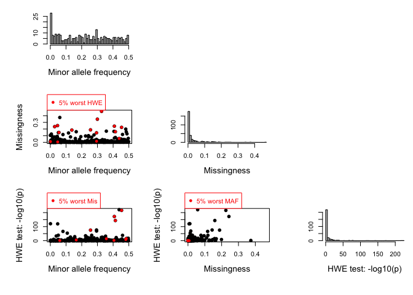
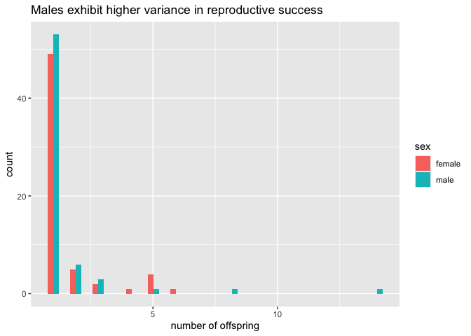

p75matrix
================

``` r
library(readxl)
library(tidyverse)
```

    ## ── Attaching core tidyverse packages ──────────────────────── tidyverse 2.0.0 ──
    ## ✔ dplyr     1.2.1     ✔ readr     2.2.0
    ## ✔ forcats   1.0.1     ✔ stringr   1.6.0
    ## ✔ ggplot2   4.0.3     ✔ tibble    3.3.1
    ## ✔ lubridate 1.9.5     ✔ tidyr     1.3.2
    ## ✔ purrr     1.2.2     
    ## ── Conflicts ────────────────────────────────────────── tidyverse_conflicts() ──
    ## ✖ dplyr::filter() masks stats::filter()
    ## ✖ dplyr::lag()    masks stats::lag()
    ## ℹ Use the conflicted package (<http://conflicted.r-lib.org/>) to force all conflicts to become errors

``` r
library(sequoia)
library(ASRgenomics)

setwd("~/Google Drive/My Drive/Nisqually/Nisqually/")

# get vector of sheet names
excel_sheets("../data-from-Adrian/Nisqually Chinook genotypes.xlsx")
```

    ##  [1] "pivot"                       "smolt trap sample genotypes"
    ##  [3] "95 random controls"          "Sheet1"                     
    ##  [5] "all loci"                    "culled"                     
    ##  [7] "genepop"                     "Sheet2"                     
    ##  [9] "genepop with assignments"    " genepop by origin"         
    ## [11] "UO gp"

``` r
# import data
dat <- 
  bind_rows(
    read_excel("../data-from-Adrian/Nisqually Chinook genotypes.xlsx", sheet="smolt trap sample genotypes", skip=1, col_types="text"), 
    read_excel("../data-from-Adrian/Nisqually Chinook genotypes.xlsx", sheet="95 random controls", skip=1, col_types="text")) |> 
  select(-random)

# cleanup column names
names(dat) <- 
  names(dat) |> 
  gsub(pattern="-", replacement="_") |> 
  gsub(pattern=" ", replacement="_") |> 
  gsub(pattern="'", replacement="_") |> 
  gsub(pattern=".", replacement="_", fixed=TRUE) |> 
  gsub(pattern="%", replacement="percent", fixed=TRUE)

print(dat)
```

    ## # A tibble: 9,103 × 319
    ##    USE_sample_name Alt_ID code  Green_DB_collection_name genotyping_year Library
    ##    <chr>           <chr>  <chr> <chr>                    <chr>           <chr>  
    ##  1 13QW0001_02     <NA>   13QW  2013 Nisqually Smolt Tr… 2018            L0036  
    ##  2 13QW0001_03     <NA>   13QW  2013 Nisqually Smolt Tr… 2018            L0036  
    ##  3 13QW0001_04     <NA>   13QW  2013 Nisqually Smolt Tr… 2018            L0036  
    ##  4 13QW0001_05     <NA>   13QW  2013 Nisqually Smolt Tr… 2018            L0036  
    ##  5 13QW0001_06     <NA>   13QW  2013 Nisqually Smolt Tr… 2018            L0036  
    ##  6 13QW0001_07     <NA>   13QW  2013 Nisqually Smolt Tr… 2018            L0036  
    ##  7 13QW0001_08     <NA>   13QW  2013 Nisqually Smolt Tr… 2018            L0036  
    ##  8 13QW0001_09     <NA>   13QW  2013 Nisqually Smolt Tr… 2018            L0036  
    ##  9 13QW0001_10     <NA>   13QW  2013 Nisqually Smolt Tr… 2018            L0036  
    ## 10 13QW0001_11     <NA>   13QW  2013 Nisqually Smolt Tr… 2018            L0036  
    ## # ℹ 9,093 more rows
    ## # ℹ 313 more variables: Plate <chr>, Well <chr>, IFI <chr>, Life_history <chr>,
    ## #   `__` <chr>, AA <chr>, CC <chr>, GG <chr>, TT <chr>, homozygosity <chr>,
    ## #   species_ID <chr>, Sex_ID <chr>, count <chr>, percent <chr>,
    ## #   Ots_SEXY3_1 <chr>, Ots_100884_287 <chr>, Ots_101119_381 <chr>,
    ## #   Ots_101554_407 <chr>, Ots_101704_143 <chr>, Ots_101770_82 <chr>,
    ## #   Ots_102213_210 <chr>, Ots_102414_395 <chr>, Ots_102457_132 <chr>, …

``` r
table(dat$Life_history, useNA="ifany")
```

    ## 
    ##    adult juvenile 
    ##       95     9008

``` r
dat2 <-
  read_csv("../data-from-Adrian/newhybrids_assignments.csv")
```

    ## Rows: 9008 Columns: 2
    ## ── Column specification ────────────────────────────────────────────────────────
    ## Delimiter: ","
    ## chr (2): sample_name, newhybrids
    ## 
    ## ℹ Use `spec()` to retrieve the full column specification for this data.
    ## ℹ Specify the column types or set `show_col_types = FALSE` to quiet this message.

``` r
print(dat2)
```

    ## # A tibble: 9,008 × 2
    ##    sample_name newhybrids
    ##    <chr>       <chr>     
    ##  1 13QW0001_02 F1Hybrid  
    ##  2 13QW0001_03 ClearCreek
    ##  3 13QW0001_04 ClearCreek
    ##  4 13QW0001_05 unassigned
    ##  5 13QW0001_06 UO        
    ##  6 13QW0001_07 ClearCreek
    ##  7 13QW0001_08 unassigned
    ##  8 13QW0001_09 unassigned
    ##  9 13QW0001_10 ClearCreek
    ## 10 13QW0001_11 F1Hybrid  
    ## # ℹ 8,998 more rows

``` r
table(dat2$newhybrids)
```

    ## 
    ## ClearCreek   F1Hybrid unassigned         UO 
    ##       3082        772        997       4157

``` r
lh <- 
  select(dat, Life_history, ID=USE_sample_name, Sex=Sex_ID, BirthYear=USE_sample_name) |>
  mutate(BirthYear=str_extract(BirthYear, "^\\d{2}") |> as.integer())

table(lh$BirthYear, lh$Life_history, useNA="ifany")
```

    ##     
    ##      adult juvenile
    ##   13     0     1395
    ##   14     0     1273
    ##   15     0     1187
    ##   17    38        0
    ##   18    35     1705
    ##   19    22     1477
    ##   20     0     1971

``` r
lh$BirthYear[1:9008] <- 
  lh$BirthYear[1:9008] + 1999

lh$BirthYear[9009:9103] <- 
  NA

lh <- 
  mutate(lh, BY.min=NA, BY.max=NA)

table(lh$BirthYear, lh$Sex, useNA="ifany")
```

    ##       
    ##           F    M no data
    ##   2012  662  730       3
    ##   2013  635  629       9
    ##   2014  568  617       2
    ##   2017  851  844      10
    ##   2018  721  736      20
    ##   2019 1015  925      31
    ##   <NA>   51   44       0

``` r
lh$BY.min[9009:9103] <- 
  str_extract(string=lh$ID[9009:9103], pattern="^\\d{2}") |> as.numeric() + 2000 - 6

lh$BY.max[9009:9103] <- 
  str_extract(string=lh$ID[9009:9103], pattern="^\\d{2}") |> as.numeric() + 2000 - 2


lh$Sex <- 
  gsub(pattern="F", replacement=1, lh$Sex) |>
  gsub(pattern="M", replacement=2) |>
  gsub(pattern="no data", replacement=NA) |>
  as.integer()

lh$BirthYear <- 
  as.integer(lh$BirthYear)

lh$BY.min <- 
  as.integer(lh$BY.min)

lh$BY.max <- 
  as.integer(lh$BY.max)

tail(lh)
```

    ## # A tibble: 6 × 6
    ##   Life_history ID         Sex BirthYear BY.min BY.max
    ##   <chr>        <chr>    <int>     <int>  <int>  <int>
    ## 1 adult        18QN2832     1        NA   2012   2016
    ## 2 adult        17RK3703     1        NA   2011   2015
    ## 3 adult        19QX2196     1        NA   2013   2017
    ## 4 adult        18QN3393     2        NA   2012   2016
    ## 5 adult        17RK3142     2        NA   2011   2015
    ## 6 adult        18QN2612     1        NA   2012   2016

``` r
lh$ID[1:9008] <- 
  paste0("s", lh$ID[1:9008])

lh$ID[9009:9103] <- 
  paste0("a", lh$ID[9009:9103])

gt <- 
  select(dat, ID=USE_sample_name, 22:319)

gt$ID[1:9008] <- 
  paste0("s", gt$ID[1:9008])

gt$ID[9009:9103] <- 
  paste0("a", gt$ID[9009:9103])

# filter exact duplicates
dups <-
  column_to_rownames(gt, "ID")[duplicated(column_to_rownames(gt, "ID")), ] |>
  rownames_to_column("ID") |>
  as_tibble() |>
  select(ID)

print(dups)
```

    ## # A tibble: 14 × 1
    ##    ID           
    ##    <chr>        
    ##  1 s13QW0004_30 
    ##  2 s13QW0012_110
    ##  3 s13QW0013_049
    ##  4 s13QW0015_010
    ##  5 s13QW0015_082
    ##  6 s13QW0015_131
    ##  7 s13QW0015_132
    ##  8 s14TZ0002_078
    ##  9 s14TZ0002_088
    ## 10 s15JS0005_009
    ## 11 s15JS0006_008
    ## 12 s15JS0020_019
    ## 13 s15JS0054_018
    ## 14 s15JS0058_007

``` r
gt <-
  filter(gt, !ID %in% dups$ID)

lh <-
  filter(lh, !ID %in% dups$ID)

# recode INDELs as SNPs
indels <- 
  gt %>% select(where(~any(grepl("-", .x, fixed=TRUE))))

gt$Ots_128757_61R <- 
  gsub(pattern="-", replacement="G", x=gt$Ots_128757_61R)

gt$Ots_GDH_81x <- 
  gsub(pattern="-", replacement="T", x=gt$Ots_GDH_81x)

gt$Ots_Ots311_101x <- 
  gsub(pattern="-", replacement="G", x=gt$Ots_Ots311_101x)

gt$Ots_RFC2_558 <- 
  gsub(pattern="-", replacement="G", x=gt$Ots_RFC2_558)

gt$Ots_U2305_63 <- 
  gsub(pattern="-", replacement="C", x=gt$Ots_U2305_63)

gt$Ots_pigh_105 <- 
  gsub(pattern="-", replacement="G", x=gt$Ots_pigh_105)

gt$Ots_u07_17_373 <- 
  gsub(pattern="-", replacement="G", x=gt$Ots_u07_17_373)

gt$Ots_vatf_251 <- 
  gsub(pattern="-", replacement="A", x=gt$Ots_vatf_251)

gt <-
  gt |>
  rowwise() |>
  mutate(perc=sum(is.na(c_across(2:299)))/298) |> 
  ungroup()


# filter individuals with at least 75% calls
gt <- 
  filter(gt, perc<=0.25)

lh <- 
  filter(lh[-1], ID %in% pull(gt, ID))

# recode SNPs as 012
gm <- 
  snp.recode(
    M=as.matrix(column_to_rownames(gt[-300], var="ID")), 
    recoding="ATGCto012")
```

    ## Matrix M was recoded from bi-allelic nucleotide bases to numeric.

``` r
snpstats <- SnpStats(gm$Mrecode)
```

<!-- -->

``` r
# filter SNPs with ≥ 75% calls, HWE.p ≥ 0.05/n, and Minor Allele Frequency ≥ 5%
p75af95 <-
  filter(as.data.frame(snpstats) |> rownames_to_column("ID"), Mis<=0.05) |> 
  as_tibble() %>%
  filter(HWE.p>=0.05/nrow(.)) |>
  filter(AF<=0.95)

p75af95 %>% 
  print(n=nrow(.))
```

    ## # A tibble: 153 × 4
    ##     ID                         AF      Mis    HWE.p
    ##     <chr>                   <dbl>    <dbl>    <dbl>
    ##   1 Ots_101119_381_C_T      0.943 0.00243  0.912   
    ##   2 Ots_101770_82_G_T       0.949 0.00332  0.129   
    ##   3 Ots_102213_210_G_A      0.909 0.0365   0.996   
    ##   4 Ots_102801_308_C_A      0.944 0.00641  0.827   
    ##   5 Ots_102867_609_G_A      0.738 0.00111  0.878   
    ##   6 Ots_103041_52_G_A       0.704 0.00254  0.0561  
    ##   7 Ots_103122_180_C_T      0.765 0.00177  0.920   
    ##   8 Ots_104048_194_C_T      0.707 0.0232   0.120   
    ##   9 Ots_104415_88_C_T       0.910 0.00321  0.601   
    ##  10 Ots_105105_613_C_G      0.619 0.0179   0.0252  
    ##  11 Ots_105407_117_T_A      0.859 0.0125   0.969   
    ##  12 Ots_106419b_618_T_G     0.713 0.00818  0.00675 
    ##  13 Ots_106499_70_C_G       0.532 0.00387  0.979   
    ##  14 Ots_106747_239_A_C      0.805 0.00221  0.146   
    ##  15 Ots_107074_284_T_A      0.817 0.00475  0.606   
    ##  16 Ots_107285_93_T_A       0.823 0.00254  0.474   
    ##  17 Ots_107607_315_C_A      0.780 0.00321  0.160   
    ##  18 Ots_107806_821_T_A      0.703 0.0361   0.0125  
    ##  19 Ots_108007_208_T_A      0.555 0.00276  0.326   
    ##  20 Ots_108390_329_C_G      0.770 0.00497  0.00570 
    ##  21 Ots_108820_336_A_G      0.875 0.00785  0.0143  
    ##  22 Ots_109693_392_G_T      0.804 0.000663 0.837   
    ##  23 Ots_110064_383_C_T      0.597 0.00210  0.739   
    ##  24 Ots_110201_363_T_A      0.905 0.0126   0.995   
    ##  25 Ots_110381_164_A_G      0.895 0.00840  0.106   
    ##  26 Ots_110495_380_G_C      0.533 0.0424   0.214   
    ##  27 Ots_110551_64_C_A       0.709 0.00984  0.428   
    ##  28 Ots_111084b_619_C_A     0.696 0.0263   0.445   
    ##  29 Ots_111681_657_T_G      0.562 0.0340   0.00204 
    ##  30 Ots_112419_131_A_T      0.559 0.0117   0.151   
    ##  31 Ots_112820_284_C_T      0.550 0.0101   0.251   
    ##  32 Ots_112876_371_C_A      0.588 0.00387  1.000   
    ##  33 Ots_113242_216_T_C      0.506 0.00464  0.448   
    ##  34 Ots_113457_40R_T_C      0.681 0.0227   0.369   
    ##  35 Ots_115987_325_T_G      0.699 0.00741  0.00406 
    ##  36 Ots_117242_136_A_G      0.693 0.00475  0.00244 
    ##  37 Ots_117259_271_T_G      0.724 0.00420  0.999   
    ##  38 Ots_117432_409_G_A      0.830 0.000884 0.830   
    ##  39 Ots_118175_479_C_T      0.703 0.00453  0.0252  
    ##  40 Ots_118205_61_C_T       0.803 0.00321  0.995   
    ##  41 Ots_120950_417_A_T      0.632 0.00497  1.000   
    ##  42 Ots_122414_56_C_T       0.690 0.00254  0.0480  
    ##  43 Ots_123048_521_A_C      0.661 0.00199  0.0192  
    ##  44 Ots_124774_477_C_T      0.522 0.0264   0.677   
    ##  45 Ots_127236_62_A_T       0.606 0.0196   0.0331  
    ##  46 Ots_127760_569_C_T      0.838 0.0252   0.000246
    ##  47 Ots_128302_57_T_C       0.922 0.0322   0.404   
    ##  48 Ots_128693_461_T_C      0.566 0.00431  0.565   
    ##  49 Ots_128757_61R_G_A      0.653 0.00298  0.916   
    ##  50 Ots_129144_472_A_C      0.796 0.00486  0.668   
    ##  51 Ots_129458_451_C_T      0.761 0.00365  0.00157 
    ##  52 Ots_130720_99_A_G       0.620 0.00243  0.311   
    ##  53 Ots_131460_584_T_C      0.503 0.00409  0.00345 
    ##  54 Ots_131906_141_A_T      0.592 0.00475  0.330   
    ##  55 Ots_94857_232R_T_C      0.655 0.00243  0.772   
    ##  56 Ots_94903_99R_G_T       0.743 0.00586  0.458   
    ##  57 Ots_96500_180_G_T       0.726 0.0220   0.00452 
    ##  58 Ots_97077_179R_T_G      0.734 0.00497  0.592   
    ##  59 Ots_99550_204_C_T       0.813 0.00343  0.0970  
    ##  60 Ots_AsnRS_60_C_T        0.677 0.0227   0.316   
    ##  61 Ots_BMP2_SNP1_C_T       0.886 0.00895  0.0339  
    ##  62 Ots_CCR7_T_C            0.562 0.0440   0.00832 
    ##  63 Ots_CD59_2_G_A          0.637 0.0229   0.657   
    ##  64 Ots_DDX5_171_C_T        0.856 0.000884 0.339   
    ##  65 Ots_E2_275_G_A          0.773 0.00608  0.575   
    ##  66 Ots_EP_529_G_A          0.934 0.000774 0.454   
    ##  67 Ots_EndoRB1_486_G_A     0.706 0.00210  0.956   
    ##  68 Ots_Est740_T_C          0.746 0.00973  0.0128  
    ##  69 Ots_FGF6B_1_C_A         0.620 0.0123   0.272   
    ##  70 Ots_GCSH_C_T            0.903 0.00332  0.00937 
    ##  71 Ots_GDH_81x_C_T         0.589 0.00486  0.0564  
    ##  72 Ots_GnRH_271_C_T        0.933 0.0286   0.0965  
    ##  73 Ots_HMGB1_73_G_T        0.621 0.00940  0.159   
    ##  74 Ots_HSP90B_100_T_C      0.931 0.000332 0.0113  
    ##  75 Ots_Hsp90a_G_C          0.690 0.0182   0.215   
    ##  76 Ots_IL8R_C8_C_T         0.891 0.00663  0.684   
    ##  77 Ots_OTALDBINT1_SNP1_C_T 0.612 0.0111   0.000284
    ##  78 Ots_OTSMTA_SNP1_T_C     0.836 0.00862  0.0351  
    ##  79 Ots_OTSTF1_SNP1_T_G     0.908 0.00718  0.242   
    ##  80 Ots_Ots311_101x_A_G     0.844 0.00188  0.934   
    ##  81 Ots_P53_G_A             0.757 0.00575  0.788   
    ##  82 Ots_PEMT_T_C            0.501 0.0106   0.0434  
    ##  83 Ots_PGK_54_A_T          0.576 0.0138   0.560   
    ##  84 Ots_Prl2_A_G            0.657 0.00663  0.00177 
    ##  85 Ots_RAG3_C_T            0.660 0.0217   0.228   
    ##  86 Ots_RFC2_558_A_G        0.602 0.00840  0.510   
    ##  87 Ots_S7_1_T_C            0.645 0.0179   0.961   
    ##  88 Ots_SClkF2R2_135_A_T    0.611 0.00243  0.313   
    ##  89 Ots_SL_G_A              0.717 0.00486  0.119   
    ##  90 Ots_SWS1op_182_A_T      0.687 0.0183   0.000722
    ##  91 Ots_TCTA_58_C_T         0.775 0.00243  0.588   
    ##  92 Ots_TGFB_C_T            0.641 0.00851  0.382   
    ##  93 Ots_U212_158_G_A        0.875 0.0140   0.158   
    ##  94 Ots_U2362_227_T_A       0.820 0.000884 0.0869  
    ##  95 Ots_U2446_123_C_A       0.702 0.0165   0.379   
    ##  96 Ots_U2567_104_G_A       0.793 0.00409  0.0400  
    ##  97 Ots_aspat_196_G_C       0.877 0.00564  0.614   
    ##  98 Ots_brp16_64_C_T        0.659 0.00232  0.569   
    ##  99 Ots_cgo24_22_C_T        0.650 0.00497  0.833   
    ## 100 Ots_cox1_241_T_C        0.726 0.00453  0.00646 
    ## 101 Ots_crRAD11620_55_C_T   0.596 0.00553  0.00371 
    ## 102 Ots_crRAD12037_39_G_A   0.565 0.0156   0.663   
    ## 103 Ots_crRAD13725_51_A_C   0.509 0.00597  0.829   
    ## 104 Ots_crRAD18492_65_C_T   0.927 0.0337   0.832   
    ## 105 Ots_crRAD18937_60_G_A   0.756 0.0170   0.00491 
    ## 106 Ots_crRAD20262_46_G_A   0.581 0.00420  0.536   
    ## 107 Ots_crRAD20887_70_A_G   0.663 0.00265  0.928   
    ## 108 Ots_crRAD21115_24_C_T   0.778 0.0167   0.955   
    ## 109 Ots_crRAD25367_50_G_T   0.513 0.00906  0.990   
    ## 110 Ots_crRAD26165_69_T_C   0.949 0.00763  0.424   
    ## 111 Ots_crRAD26541_47_G_A   0.936 0.0453   0.0605  
    ## 112 Ots_crRAD27164_55_A_T   0.930 0.00155  0.710   
    ## 113 Ots_crRAD2806_42_C_A    0.774 0.00940  0.00765 
    ## 114 Ots_crRAD28677_65_C_T   0.549 0.0497   0.0187  
    ## 115 Ots_crRAD33491_71_T_C   0.539 0.00542  0.706   
    ## 116 Ots_crRAD44588_67_C_T   0.602 0.00431  0.954   
    ## 117 Ots_crRAD46081_56_C_T   0.853 0.00774  0.989   
    ## 118 Ots_crRAD55400_59_C_T   0.882 0.00696  0.625   
    ## 119 Ots_crRAD57520_66_G_T   0.648 0.00177  0.997   
    ## 120 Ots_crRAD60620_51_A_G   0.814 0.00133  0.00820 
    ## 121 Ots_crRAD61523_71_A_G   0.876 0.00553  0.00178 
    ## 122 Ots_crRAD66330_60_G_T   0.676 0.0232   0.000374
    ## 123 Ots_crRAD69327_53_G_T   0.720 0.00265  0.461   
    ## 124 Ots_crRAD73823_60_A_T   0.510 0.00475  0.0575  
    ## 125 Ots_crRAD74766_28_G_A   0.753 0.00332  0.981   
    ## 126 Ots_crRAD78968_46_C_T   0.770 0.0102   0.655   
    ## 127 Ots_crRAD92420_25_G_T   0.896 0.00807  0.146   
    ## 128 Ots_crRAD9615_69_T_C    0.874 0.000884 0.358   
    ## 129 Ots_hsc71_3__488_C_T    0.828 0.00873  0.0449  
    ## 130 Ots_hsp27b_150_G_A      0.662 0.00453  0.767   
    ## 131 Ots_mybp_85_T_C         0.633 0.0219   0.159   
    ## 132 Ots_myo1a_384_A_C       0.791 0.00210  0.900   
    ## 133 Ots_myoD_364_G_T        0.508 0.0199   0.217   
    ## 134 Ots_nelfd_163_G_A       0.566 0.0114   0.0411  
    ## 135 Ots_nramp_321_A_G       0.778 0.00497  0.977   
    ## 136 Ots_ntl_255_T_A         0.833 0.00376  0.918   
    ## 137 Ots_parp3_286_A_G       0.809 0.00575  0.705   
    ## 138 Ots_pop5_96_T_C         0.934 0.00177  0.797   
    ## 139 Ots_tpx2_125_C_T        0.883 0.00177  0.911   
    ## 140 Ots_trnau1ap_86_G_T     0.932 0.00398  0.564   
    ## 141 Ots_u07_17_373_A_G      0.911 0.0183   0.203   
    ## 142 Ots_u07_18_378_A_T      0.820 0.00531  0.0213  
    ## 143 Ots_u07_49_290_A_G      0.701 0.00343  0.602   
    ## 144 Ots_u07_53_133_T_C      0.610 0.0235   0.256   
    ## 145 Ots_u1002_75_T_C        0.716 0.00144  0.00572 
    ## 146 Ots_u1007_124_A_G       0.848 0.00144  0.561   
    ## 147 Ots_u211_85_T_C         0.632 0.00597  0.606   
    ## 148 Ots_u4_92_T_C           0.542 0.00553  0.843   
    ## 149 Ots_unk1104_38_C_T      0.534 0.00254  0.868   
    ## 150 Ots_unk1832_39_C_T      0.768 0.00265  0.0197  
    ## 151 Ots_unk526_G_A          0.791 0.00177  0.00309 
    ## 152 Ots_unk7936_50_G_C      0.729 0.0231   0.284   
    ## 153 Ots_unk9480_51_C_G      0.772 0.00155  0.700

``` r
gm75 <- 
  snp.recode(
    M=as.matrix(column_to_rownames(select(gt[-300], c("ID", str_remove(string=p75af95$ID, pattern="[A-Z_0]{4}$"))), var="ID")), 
    recoding="ATGCto012")
```

    ## Matrix M was recoded from bi-allelic nucleotide bases to numeric.

``` r
gm75 <- 
  CheckGeno(gm75$Mrecode)
```

    ## ✔ Genotype matrix looks OK! There are  9047  individuals and  153  SNPs.

``` r
# check for duplicates
dup1 <- 
  sequoia(
    GenoM=gm75, 
    LifeHistData=as.data.frame(lh), 
    Module="dup", 
    quiet="verbose", 
    Plot=FALSE)
```

    ## ℹ Checking input data ...
    ## ✔ Genotype matrix looks OK! There are  9047  individuals and  153  SNPs.
    ## 
    ## ── Among genotyped individuals: ___ 
    ## ℹ There are 4467 females, 4508 males, 72 of unknown sex, and 0 hermaphrodites.
    ## ℹ Exact birth years are from 2012 to 2019
    ## ℹ Birth year min/max are from 2011 to 2017
    ## ___
    ## ℹ Calling `MakeAgePrior()` ...
    ## 
    ## ~~~ Duplicate check ~~~

    ##  0   10  20  30  40  50  60  70  80  90  100% 
    ##  |   |   |   |   |   |   |   |   |   |   |
    ##   ****************************************

    ## ℹ Found 107 likely duplicate genotypes,please double check and consider
    ## removing

``` r
# filter duplicates with most calls
dup1cut <- 
  bind_cols(
    filter(gt, ID %in% dup1$DupGenotype$ID1) |> select(ID1=ID, perc1=perc), 
    filter(gt, ID %in% dup1$DupGenotype$ID2) |> select(ID2=ID, perc2=perc)) %>% 
  mutate(ID=if_else(condition=perc1<=perc2, true=ID2, false=ID1))

print(dup1cut)
```

    ## # A tibble: 106 × 5
    ##    ID1           perc1 ID2            perc2 ID          
    ##    <chr>         <dbl> <chr>          <dbl> <chr>       
    ##  1 s13QW0001_25 0.0134 s13QW0001_29 0.0403  s13QW0001_29
    ##  2 s13QW0003_14 0.0134 s13QW0003_33 0.0369  s13QW0003_33
    ##  3 s13QW0005_03 0.0235 s13QW0005_19 0.0168  s13QW0005_03
    ##  4 s13QW0005_04 0.107  s13QW0005_31 0.00671 s13QW0005_04
    ##  5 s13QW0005_07 0.0101 s13QW0005_32 0.0201  s13QW0005_32
    ##  6 s13QW0005_10 0.0268 s13QW0005_37 0.0235  s13QW0005_10
    ##  7 s13QW0005_13 0.0403 s13QW0005_38 0.00671 s13QW0005_13
    ##  8 s13QW0005_27 0.221  s13QW0005_39 0.0134  s13QW0005_27
    ##  9 s13QW0005_34 0.0134 s13QW0005_41 0.0403  s13QW0005_41
    ## 10 s13QW0005_36 0.0101 s13QW0005_43 0.0134  s13QW0005_43
    ## # ℹ 96 more rows

``` r
gm75c <- 
  snp.recode(
    M=as.matrix(column_to_rownames(select(gt[-300], c("ID", str_remove(string=p75af95$ID, pattern="[A-Z_0]{4}$"))) |> filter(!ID %in% pull(dup1cut, ID)), var="ID")), 
    recoding="ATGCto012")
```

    ## Matrix M was recoded from bi-allelic nucleotide bases to numeric.

``` r
lhc <- 
  filter(lh, ID %in% rownames(gm75c$Mrecode))

gm75c <- 
  CheckGeno(gm75c$Mrecode)
```

    ## ✔ Genotype matrix looks OK! There are  8941  individuals and  153  SNPs.

``` r
dim(gm75c)
```

    ## [1] 8941  153

``` r
dim(lhc)
```

    ## [1] 8941    5

``` r
# check for duplicates again
dup2 <- 
  sequoia(
    GenoM=gm75c, 
    LifeHistData=as.data.frame(lhc), 
    Module="dup",
    quiet="verbose", 
    Plot=FALSE)
```

    ## ℹ Checking input data ...
    ## ✔ Genotype matrix looks OK! There are  8941  individuals and  153  SNPs.
    ## 
    ## ── Among genotyped individuals: ___ 
    ## ℹ There are 4419 females, 4451 males, 71 of unknown sex, and 0 hermaphrodites.
    ## ℹ Exact birth years are from 2012 to 2019
    ## ℹ Birth year min/max are from 2011 to 2017
    ## ___
    ## ℹ Calling `MakeAgePrior()` ...
    ## 
    ## ~~~ Duplicate check ~~~

    ##  0   10  20  30  40  50  60  70  80  90  100% 
    ##  |   |   |   |   |   |   |   |   |   |   |
    ##   ****************************************

    ## ℹ Found 12 likely duplicate genotypes,please double check and consider removing

``` r
dup2cut <- 
  bind_cols(
    filter(gt, ID %in% dup2$DupGenotype$ID1) |> select(ID1=ID, perc1=perc), 
    filter(gt, ID %in% dup2$DupGenotype$ID2) |> select(ID2=ID, perc2=perc)) %>% 
  mutate(ID=if_else(condition=perc1<=perc2, true=ID2, false=ID1))

# estimate parentage
par1 <- 
  sequoia(
    GenoM=gm75c[rownames(gm75c)[!rownames(gm75c) %in% dup2cut$ID], ], 
    LifeHistData=as.data.frame(lhc) |> filter(!ID %in% dup2cut$ID), 
    Module="par",
    quiet="verbose", 
    Plot=FALSE)
```

    ## ℹ Checking input data ...
    ## ✔ Genotype matrix looks OK! There are  8929  individuals and  153  SNPs.
    ## 
    ## ── Among genotyped individuals: ___ 
    ## ℹ There are 4417 females, 4442 males, 70 of unknown sex, and 0 hermaphrodites.
    ## ℹ Exact birth years are from 2012 to 2019
    ## ℹ Birth year min/max are from 2011 to 2017
    ## ___
    ## ℹ Calling `MakeAgePrior()` ...
    ## ℹ Ageprior: Flat 0/1, overlapping generations, MaxAgeParent = 9,9
    ## 
    ## ~~~ Duplicate check ~~~

    ##  0   10  20  30  40  50  60  70  80  90  100% 
    ##  |   |   |   |   |   |   |   |   |   |   |
    ##   ****************************************

    ## ✔ No potential duplicates found
    ## 
    ## ~~~ Parentage assignment ~~~

    ## 
    ##  Time    |  R |  Step      |  Progress  | Dams  | Sires |  GPs  |   Total LL 
    ## -------- | -- | ---------- | ---------- | ----- | ----- | ----- | ----------
    ## 14:29:42 |  0 | count OH   |            | 
    ## 14:29:42 |  0 | initial    |            |     0 |     0 |     0 |  -488672.1 
    ## 14:29:42 |  1 | parents    | .......... |    95 |   100 |     0 |  -487203.1 
    ## 14:30:00 |  2 | parents    | .......... |    95 |   101 |     0 |  -487200.2 
    ## 14:30:17 |  3 | parents    | .......... |    96 |   101 |     0 |  -487196.1 
    ## 14:30:35 |  4 | parents    | .......... |    95 |   101 |     0 |  -487200.2 
    ## 14:30:53 | 99 | est byears | .......... |

    ## ✔ assigned 95 dams and 101 sires to 8929 individuals 
    ## ℹ You can use `SummarySeq()` for pedigree details, `CalcParentProbs()` for
    ## assignment probabilities, and `EstConf()` for confidence estimates
    ## ℹ Run `GetMaybeRel()` conditional on this pedigree to check for any
    ## non-assigned parents

``` r
filter(par1$PedigreePar, !is.na(dam) | !is.na(sire)) |> 
  as_tibble() |> 
  select(-LLRdam, -LLRsire, -LLRpair) %>% 
  print(n=nrow(.))
```

    ## # A tibble: 193 × 6
    ##     id            dam           sire          OHdam OHsire MEpair
    ##     <chr>         <chr>         <chr>         <int>  <int>  <int>
    ##   1 s14TZ0001_108 s13QW0012_052 <NA>              0     NA     NA
    ##   2 s14TZ0002_006 s13QW0011_027 <NA>              0     NA     NA
    ##   3 s14TZ0006_010 s13QW0009_103 <NA>              0     NA     NA
    ##   4 s14TZ0008_009 s13QW0011_088 <NA>              0     NA     NA
    ##   5 s15JS0034_005 <NA>          s13QW0004_24     NA      0     NA
    ##   6 s15JS0043_008 s13QW0009_108 <NA>              0     NA     NA
    ##   7 s18GX0010_1   <NA>          s14TZ0008_111    NA      0     NA
    ##   8 s18GX0010_2   s14TZ0003_003 <NA>              0     NA     NA
    ##   9 s18GX0039_1   s15JS0001_005 <NA>              0     NA     NA
    ##  10 s18GX0044_3   <NA>          s15JS0044_013    NA      0     NA
    ##  11 s18GX0054_3   <NA>          a17RK2386        NA      0     NA
    ##  12 s18GX0060_4   <NA>          a17RK2386        NA      0     NA
    ##  13 s18GX0067_5   a17RK3793     <NA>              0     NA     NA
    ##  14 s18GX0067_8   a17RK2671     <NA>              0     NA     NA
    ##  15 s18GX0068_5   a17RK3793     <NA>              0     NA     NA
    ##  16 s18GX0070_6   <NA>          s15JS0011_010    NA      1     NA
    ##  17 s18GX0075_7   a17RK3793     <NA>              0     NA     NA
    ##  18 s18GX0077_7   s14TZ0003_003 <NA>              0     NA     NA
    ##  19 s18GX0078_2   <NA>          s14TZ0005_045    NA      0     NA
    ##  20 s18GX0078_7   a17RK3793     <NA>              0     NA     NA
    ##  21 s18GX0079_9   s14TZ0003_003 <NA>              0     NA     NA
    ##  22 s18GX0083_8   s14TZ0003_003 <NA>              0     NA     NA
    ##  23 s18GX0089_2   <NA>          s15JS0036_011    NA      0     NA
    ##  24 s18GX0093_3   s15JS0201_020 <NA>              0     NA     NA
    ##  25 s18GX0095_1   <NA>          s15JS0020_009    NA      0     NA
    ##  26 s18GX0097_6   s14TZ0003_003 <NA>              0     NA     NA
    ##  27 s18GX0099_4   s14TZ0004_113 <NA>              0     NA     NA
    ##  28 s18GX0113_5   <NA>          s14TZ0001_013    NA      1     NA
    ##  29 s18GX0120_1   <NA>          s14TZ0008_091    NA      0     NA
    ##  30 s18GX0122_4   s14TZ0006_062 <NA>              0     NA     NA
    ##  31 s18GX0133_7   a17RK2082     <NA>              0     NA     NA
    ##  32 s18GX0135_3   s14TZ0007_031 <NA>              0     NA     NA
    ##  33 s18GX0138_2   <NA>          s15JS0025_014    NA      0     NA
    ##  34 s18GX0139_4   <NA>          s14TZ0001_099    NA      0     NA
    ##  35 s18GX0140_6   s14TZ0003_059 <NA>              0     NA     NA
    ##  36 s18GX0141_2   <NA>          s14TZ0004_124    NA      0     NA
    ##  37 s18GX0146_3   <NA>          s15JS0020_009    NA      0     NA
    ##  38 s18GX0148_2   s14TZ0001_092 <NA>              0     NA     NA
    ##  39 s18GX0149_3   <NA>          s14TZ0008_112    NA      0     NA
    ##  40 s18GX0150_5   <NA>          s15JS0008_008    NA      0     NA
    ##  41 s18GX0151_4   s15JS0002_001 s15JS0061_016     0      1      1
    ##  42 s18GX0154_4   a17RK3793     <NA>              0     NA     NA
    ##  43 s18GX0157_1   <NA>          s15JS0036_011    NA      0     NA
    ##  44 s18GX0158_3   <NA>          a17RK3106        NA      0     NA
    ##  45 s18GX0160_5   <NA>          s15JS0020_009    NA      0     NA
    ##  46 s18GX0161_1   s15JS0018_008 <NA>              0     NA     NA
    ##  47 s18GX0163_2   <NA>          a17RK3038        NA      0     NA
    ##  48 s18GX0163_4   <NA>          a17RK3106        NA      0     NA
    ##  49 s18GX0167_9   s15JS0028_011 <NA>              0     NA     NA
    ##  50 s18GX0178_4   s15JS0050_019 <NA>              0     NA     NA
    ##  51 s18GX0179_8   s15JS0061_012 <NA>              0     NA     NA
    ##  52 s18GX0181_8   s14TZ0008_092 <NA>              0     NA     NA
    ##  53 s18GX0185_7   <NA>          s15JS0036_011    NA      0     NA
    ##  54 s18GX0186_1   <NA>          s15JS0002_015    NA      0     NA
    ##  55 s18GX0192_5   <NA>          a17RK2020        NA      0     NA
    ##  56 s18GX0193_3   s14TZ0008_034 <NA>              0     NA     NA
    ##  57 s18GX0198_8   s14TZ0007_025 <NA>              0     NA     NA
    ##  58 s18GX0199_9   s15JS0041_017 <NA>              1     NA     NA
    ##  59 s18GX0203_6   <NA>          s15JS0017_018    NA      1     NA
    ##  60 s18GX0206_1   <NA>          s15JS0020_009    NA      0     NA
    ##  61 s18GX0207_2   <NA>          a17RK2020        NA      0     NA
    ##  62 s18GX0208_4   <NA>          s15JS0020_009    NA      0     NA
    ##  63 s18GX0208_6   <NA>          s15JS0002_009    NA      0     NA
    ##  64 s18GX0210_8   <NA>          s14TZ0007_090    NA      0     NA
    ##  65 s18GX0217_2   s15JS0201_020 <NA>              0     NA     NA
    ##  66 s18GX0217_5   <NA>          s15JS0036_011    NA      0     NA
    ##  67 s18GX0217_8   <NA>          s15JS0036_011    NA      0     NA
    ##  68 s18GX0228_8   <NA>          s15JS0036_011    NA      0     NA
    ##  69 s18GX0231_1   <NA>          s14TZ0011_066    NA      0     NA
    ##  70 s18GX0235_7   s15JS0002_001 s15JS0036_011     0      0      0
    ##  71 s18GX0239_5   s15JS0002_001 <NA>              0     NA     NA
    ##  72 s18GX0240_6   s15JS0201_020 <NA>              0     NA     NA
    ##  73 s18GX0243_3   s15JS0033_012 <NA>              0     NA     NA
    ##  74 s18GX0243_4   <NA>          s15JS0036_011    NA      0     NA
    ##  75 s18GX0244_1   <NA>          s14TZ0011_079    NA      0     NA
    ##  76 s18GX0246_2   s15JS0002_001 s15JS0036_011     0      0      0
    ##  77 s18GX0247_3   <NA>          s15JS0060_008    NA      0     NA
    ##  78 s18GX0248_1   s15JS0002_001 <NA>              0     NA     NA
    ##  79 s18GX0251_5   <NA>          s15JS0046_004    NA      0     NA
    ##  80 s18GX0254_8   s15JS0201_020 <NA>              0     NA     NA
    ##  81 s18GX0261_2   <NA>          s15JS0036_011    NA      0     NA
    ##  82 s18GX0275_7   <NA>          s15JS0032_016    NA      0     NA
    ##  83 s18GX0276_7   s14TZ0007_025 <NA>              0     NA     NA
    ##  84 s18GX0277_4   <NA>          a17RK2020        NA      0     NA
    ##  85 s18GX0277_8   <NA>          s15JS0049_019    NA      0     NA
    ##  86 s18GX0278_2   s15JS0008_006 <NA>              0     NA     NA
    ##  87 s18GX0283_1   <NA>          s15JS0044_012    NA      0     NA
    ##  88 s18GX0283_7   s15JS0018_008 <NA>              0     NA     NA
    ##  89 s18GX0283_8   <NA>          s15JS0040_009    NA      0     NA
    ##  90 s18GX0285_2   s15JS0031_009 <NA>              1     NA     NA
    ##  91 s18GX0288_7   s15JS0045_001 <NA>              0     NA     NA
    ##  92 s18GX0291_8   <NA>          s15JS0061_005    NA      0     NA
    ##  93 s18GX0292_8   <NA>          s15JS0046_004    NA      0     NA
    ##  94 s18GX0294_4   <NA>          s15JS0036_011    NA      0     NA
    ##  95 s18GX0298_1   <NA>          s15JS0036_011    NA      0     NA
    ##  96 s18GX0298_5   s15JS0036_007 <NA>              1     NA     NA
    ##  97 s18GX0299_3   <NA>          s15JS0032_016    NA      0     NA
    ##  98 s18GX0305_6   <NA>          s15JS0046_011    NA      0     NA
    ##  99 s18GX0307_1   <NA>          s15JS0032_016    NA      0     NA
    ## 100 s18GX0309_6   <NA>          s15JS0036_011    NA      0     NA
    ## 101 s18GX0309_7   <NA>          s15JS0056_013    NA      0     NA
    ## 102 s18GX0310_4   <NA>          s15JS0028_006    NA      1     NA
    ## 103 s19DY0127     <NA>          s18GX0158_6      NA      1     NA
    ## 104 s19DY0182     a18QN3058     <NA>              0     NA     NA
    ## 105 s19DY0232     <NA>          a19QX2725        NA      0     NA
    ## 106 s19DY0304     a18QN3745     <NA>              0     NA     NA
    ## 107 s19DY0360     s18GX0157_6   <NA>              0     NA     NA
    ## 108 s19DY0366     s15JS0010_017 <NA>              0     NA     NA
    ## 109 s19DY0390     <NA>          a18QN3757        NA      0     NA
    ## 110 s19DY0469     a18QN3745     <NA>              0     NA     NA
    ## 111 s19DY0472     a18QN3745     <NA>              0     NA     NA
    ## 112 s19DY0494     s15JS0009_015 <NA>              1     NA     NA
    ## 113 s19DY0606     <NA>          s14TZ0002_051    NA      0     NA
    ## 114 s19DY0704     s15JS0016_011 <NA>              0     NA     NA
    ## 115 s19DY0759     <NA>          s15JS0050_003    NA      0     NA
    ## 116 s19DY0769     s15JS0005_014 <NA>              1     NA     NA
    ## 117 s19DY0781     s15JS0010_017 <NA>              0     NA     NA
    ## 118 s19DY0784     <NA>          s15JS0201_011    NA      0     NA
    ## 119 s19DY0793     <NA>          s15JS0201_002    NA      0     NA
    ## 120 s19DY0812     s15JS0006_011 <NA>              1     NA     NA
    ## 121 s19DY0840     a18QN2710     <NA>              0     NA     NA
    ## 122 s19DY0870     s15JS0016_011 <NA>              0     NA     NA
    ## 123 s19DY0871     <NA>          s15JS0002_009    NA      0     NA
    ## 124 s19DY0883     s15JS0010_017 <NA>              0     NA     NA
    ## 125 s19DY0902     s15JS0041_004 <NA>              1     NA     NA
    ## 126 s19DY0929     s15JS0010_017 <NA>              0     NA     NA
    ## 127 s19DY0970     <NA>          s15JS0202_019    NA      0     NA
    ## 128 s19DY0976     s15JS0032_017 <NA>              1     NA     NA
    ## 129 s19DY0979     s15JS0010_017 <NA>              0     NA     NA
    ## 130 s19DY1012     s15JS0031_017 <NA>              0     NA     NA
    ## 131 s19DY1015     s15JS0050_019 <NA>              0     NA     NA
    ## 132 s19DY1028     s15JS0016_011 <NA>              0     NA     NA
    ## 133 s19DY1030     <NA>          s15JS0036_010    NA      0     NA
    ## 134 s19DY1040     s18GX0277_5   <NA>              0     NA     NA
    ## 135 s19DY1056     <NA>          s15JS0021_015    NA      1     NA
    ## 136 s19DY1065     <NA>          a18QN3757        NA      0     NA
    ## 137 s19DY1069     <NA>          s15JS0030_004    NA      0     NA
    ## 138 s19DY1102     <NA>          s15JS0030_004    NA      0     NA
    ## 139 s19DY1134     s15JS0031_017 <NA>              0     NA     NA
    ## 140 s19DY1151     s15JS0016_011 <NA>              0     NA     NA
    ## 141 s19DY1170     <NA>          s15JS0030_004    NA      0     NA
    ## 142 s19DY1175     s15JS0016_011 <NA>              0     NA     NA
    ## 143 s19DY1190     s15JS0016_011 <NA>              0     NA     NA
    ## 144 s19DY1199     s15JS0043_002 <NA>              0     NA     NA
    ## 145 s19DY1212     <NA>          s15JS0030_004    NA      0     NA
    ## 146 s19DY1221     <NA>          s15JS0047_011    NA      0     NA
    ## 147 s19DY1222     s13QW0004_23  <NA>              0     NA     NA
    ## 148 s19DY1236     <NA>          s15JS0036_011    NA      0     NA
    ## 149 s19DY1265     s18GX0244_1   <NA>              0     NA     NA
    ## 150 s19DY1283     <NA>          s18GX0198_8      NA      0     NA
    ## 151 s19DY1293     s15JS0031_006 <NA>              0     NA     NA
    ## 152 s19DY1299     <NA>          s15JS0050_002    NA      0     NA
    ## 153 s19DY1304     <NA>          s15JS0030_004    NA      0     NA
    ## 154 s19DY1333     <NA>          s15JS0053_005    NA      0     NA
    ## 155 s19DY1344     <NA>          s15JS0030_004    NA      0     NA
    ## 156 s19DY1351     s15JS0061_006 <NA>              0     NA     NA
    ## 157 s19DY1357     <NA>          s15JS0030_004    NA      0     NA
    ## 158 s19DY1394     s15JS0049_012 <NA>              0     NA     NA
    ## 159 s19DY1409     s15JS0064_003 <NA>              0     NA     NA
    ## 160 s19DY1413     <NA>          s15JS0030_004    NA      0     NA
    ## 161 s19DY1434     <NA>          s15JS0060_018    NA      1     NA
    ## 162 s19DY1480     s15JS0041_017 <NA>              1     NA     NA
    ## 163 s19DY1497     s15JS0042_011 <NA>              0     NA     NA
    ## 164 s20LV0012     <NA>          a19QX3667        NA      0     NA
    ## 165 s20LV0224     <NA>          s14TZ0003_087    NA      0     NA
    ## 166 s20LV0286     s19DY0669     <NA>              0     NA     NA
    ## 167 s20LV0419     <NA>          s15JS0037_009    NA      0     NA
    ## 168 s20LV0456     <NA>          s14TZ0003_056    NA      0     NA
    ## 169 s20LV0679     s19DY1408     <NA>              0     NA     NA
    ## 170 s20LV0783     a19QX2196     <NA>              0     NA     NA
    ## 171 s20LV0945     <NA>          s14TZ0007_048    NA      0     NA
    ## 172 s20LV1084     a19QX2196     <NA>              0     NA     NA
    ## 173 s20LV1204     s18GX0140_2   <NA>              0     NA     NA
    ## 174 s20LV1295     <NA>          s13QW0015_104    NA      0     NA
    ## 175 s20LV1305     <NA>          s13QW0012_001    NA      0     NA
    ## 176 s20LV1328     <NA>          a19QX3667        NA      0     NA
    ## 177 s20LV1350     a19QX2196     <NA>              0     NA     NA
    ## 178 s20LV1422     <NA>          s14TZ0002_051    NA      0     NA
    ## 179 s20LV1453     <NA>          s14TZ0011_071    NA      0     NA
    ## 180 s20LV1485     s14TZ0006_023 <NA>              0     NA     NA
    ## 181 s20LV1497     <NA>          s18GX0140_5      NA      0     NA
    ## 182 s20LV1633     <NA>          s13QW0005_35     NA      0     NA
    ## 183 s20LV1712     <NA>          s14TZ0010_007    NA      0     NA
    ## 184 s20LV1765     s18GX0089_2   <NA>              0     NA     NA
    ## 185 s20LV1785     s18GX0111_5   <NA>              0     NA     NA
    ## 186 s20LV1939     s15JS0051_014 <NA>              0     NA     NA
    ## 187 s20LV1943     <NA>          s14TZ0009_075    NA      0     NA
    ## 188 s20LV1985     s14TZ0009_057 <NA>              0     NA     NA
    ## 189 s20LV2062     s18GX0177_1   <NA>              0     NA     NA
    ## 190 s20LV2123     <NA>          s18GX0185_3      NA      0     NA
    ## 191 s20LV2332     <NA>          s18GX0320_6      NA      0     NA
    ## 192 s20LV2465     s19DY1223     <NA>              0     NA     NA
    ## 193 a19QX2655     <NA>          s14TZ0002_051    NA      0     NA

``` r
tibble(
  x=c(table(par1$PedigreePar$dam), table(par1$PedigreePar$sire)), 
  sex=c(rep("female", table(par1$PedigreePar$dam) |> length()), rep("male", table(par1$PedigreePar$sire) |> length()))) |> 
  ggplot(aes(x=x, fill=sex)) + 
  geom_histogram(position="dodge") + 
  labs(x="number of offspring", title="Males exhibit higher variance in reproductive success")
```

    ## `stat_bin()` using `bins = 30`. Pick better value `binwidth`.

<!-- -->

``` r
female <- 
  c(mean=table(par1$PedigreePar$dam) |> mean(), 
    sd=table(par1$PedigreePar$dam) |> sd())

male <- 
  c(mean=table(par1$PedigreePar$sire) |> mean(), 
    sd=table(par1$PedigreePar$sire) |> sd())

round(female, 2)
```

    ## mean   sd 
    ## 1.53 1.24

``` r
round(male, 2)
```

    ## mean   sd 
    ## 1.55 1.90

``` r
assignments <-
  dat2 |> 
  mutate(ID=paste0("s", sample_name)) |> 
  select(3, 2)

par1par <- 
  filter(par1$PedigreePar, !is.na(dam) | !is.na(sire)) |>
  left_join(y=assignments, by=join_by(id==ID)) |> 
  rename(offspring=newhybrids) |> 
  left_join(y=assignments, by=join_by(dam==ID)) |> 
  rename(maternal=newhybrids) |> 
  left_join(y=assignments, by=join_by(sire==ID)) |> 
  rename(paternal=newhybrids) |> 
  as_tibble() |> 
  select(-LLRdam, -LLRsire, -LLRpair) 

par1par %>% 
  print(n=nrow(.))
```

    ## # A tibble: 193 × 9
    ##     id            dam      sire  OHdam OHsire MEpair offspring maternal paternal
    ##     <chr>         <chr>    <chr> <int>  <int>  <int> <chr>     <chr>    <chr>   
    ##   1 s14TZ0001_108 s13QW00… <NA>      0     NA     NA ClearCre… ClearCr… <NA>    
    ##   2 s14TZ0002_006 s13QW00… <NA>      0     NA     NA ClearCre… ClearCr… <NA>    
    ##   3 s14TZ0006_010 s13QW00… <NA>      0     NA     NA ClearCre… ClearCr… <NA>    
    ##   4 s14TZ0008_009 s13QW00… <NA>      0     NA     NA ClearCre… ClearCr… <NA>    
    ##   5 s15JS0034_005 <NA>     s13Q…    NA      0     NA UO        <NA>     UO      
    ##   6 s15JS0043_008 s13QW00… <NA>      0     NA     NA ClearCre… ClearCr… <NA>    
    ##   7 s18GX0010_1   <NA>     s14T…    NA      0     NA ClearCre… <NA>     ClearCr…
    ##   8 s18GX0010_2   s14TZ00… <NA>      0     NA     NA ClearCre… ClearCr… <NA>    
    ##   9 s18GX0039_1   s15JS00… <NA>      0     NA     NA UO        unassig… <NA>    
    ##  10 s18GX0044_3   <NA>     s15J…    NA      0     NA unassign… <NA>     UO      
    ##  11 s18GX0054_3   <NA>     a17R…    NA      0     NA ClearCre… <NA>     <NA>    
    ##  12 s18GX0060_4   <NA>     a17R…    NA      0     NA ClearCre… <NA>     <NA>    
    ##  13 s18GX0067_5   a17RK37… <NA>      0     NA     NA ClearCre… <NA>     <NA>    
    ##  14 s18GX0067_8   a17RK26… <NA>      0     NA     NA ClearCre… <NA>     <NA>    
    ##  15 s18GX0068_5   a17RK37… <NA>      0     NA     NA ClearCre… <NA>     <NA>    
    ##  16 s18GX0070_6   <NA>     s15J…    NA      1     NA UO        <NA>     UO      
    ##  17 s18GX0075_7   a17RK37… <NA>      0     NA     NA ClearCre… <NA>     <NA>    
    ##  18 s18GX0077_7   s14TZ00… <NA>      0     NA     NA ClearCre… ClearCr… <NA>    
    ##  19 s18GX0078_2   <NA>     s14T…    NA      0     NA F1Hybrid  <NA>     ClearCr…
    ##  20 s18GX0078_7   a17RK37… <NA>      0     NA     NA ClearCre… <NA>     <NA>    
    ##  21 s18GX0079_9   s14TZ00… <NA>      0     NA     NA F1Hybrid  ClearCr… <NA>    
    ##  22 s18GX0083_8   s14TZ00… <NA>      0     NA     NA unassign… ClearCr… <NA>    
    ##  23 s18GX0089_2   <NA>     s15J…    NA      0     NA UO        <NA>     UO      
    ##  24 s18GX0093_3   s15JS02… <NA>      0     NA     NA unassign… UO       <NA>    
    ##  25 s18GX0095_1   <NA>     s15J…    NA      0     NA F1Hybrid  <NA>     ClearCr…
    ##  26 s18GX0097_6   s14TZ00… <NA>      0     NA     NA F1Hybrid  ClearCr… <NA>    
    ##  27 s18GX0099_4   s14TZ00… <NA>      0     NA     NA unassign… ClearCr… <NA>    
    ##  28 s18GX0113_5   <NA>     s14T…    NA      1     NA ClearCre… <NA>     ClearCr…
    ##  29 s18GX0120_1   <NA>     s14T…    NA      0     NA UO        <NA>     F1Hybrid
    ##  30 s18GX0122_4   s14TZ00… <NA>      0     NA     NA F1Hybrid  ClearCr… <NA>    
    ##  31 s18GX0133_7   a17RK20… <NA>      0     NA     NA ClearCre… <NA>     <NA>    
    ##  32 s18GX0135_3   s14TZ00… <NA>      0     NA     NA UO        UO       <NA>    
    ##  33 s18GX0138_2   <NA>     s15J…    NA      0     NA UO        <NA>     UO      
    ##  34 s18GX0139_4   <NA>     s14T…    NA      0     NA unassign… <NA>     ClearCr…
    ##  35 s18GX0140_6   s14TZ00… <NA>      0     NA     NA F1Hybrid  ClearCr… <NA>    
    ##  36 s18GX0141_2   <NA>     s14T…    NA      0     NA ClearCre… <NA>     ClearCr…
    ##  37 s18GX0146_3   <NA>     s15J…    NA      0     NA F1Hybrid  <NA>     ClearCr…
    ##  38 s18GX0148_2   s14TZ00… <NA>      0     NA     NA ClearCre… ClearCr… <NA>    
    ##  39 s18GX0149_3   <NA>     s14T…    NA      0     NA unassign… <NA>     ClearCr…
    ##  40 s18GX0150_5   <NA>     s15J…    NA      0     NA UO        <NA>     UO      
    ##  41 s18GX0151_4   s15JS00… s15J…     0      1      1 UO        unassig… UO      
    ##  42 s18GX0154_4   a17RK37… <NA>      0     NA     NA ClearCre… <NA>     <NA>    
    ##  43 s18GX0157_1   <NA>     s15J…    NA      0     NA UO        <NA>     UO      
    ##  44 s18GX0158_3   <NA>     a17R…    NA      0     NA ClearCre… <NA>     <NA>    
    ##  45 s18GX0160_5   <NA>     s15J…    NA      0     NA unassign… <NA>     ClearCr…
    ##  46 s18GX0161_1   s15JS00… <NA>      0     NA     NA UO        UO       <NA>    
    ##  47 s18GX0163_2   <NA>     a17R…    NA      0     NA ClearCre… <NA>     <NA>    
    ##  48 s18GX0163_4   <NA>     a17R…    NA      0     NA ClearCre… <NA>     <NA>    
    ##  49 s18GX0167_9   s15JS00… <NA>      0     NA     NA UO        UO       <NA>    
    ##  50 s18GX0178_4   s15JS00… <NA>      0     NA     NA UO        UO       <NA>    
    ##  51 s18GX0179_8   s15JS00… <NA>      0     NA     NA F1Hybrid  F1Hybrid <NA>    
    ##  52 s18GX0181_8   s14TZ00… <NA>      0     NA     NA UO        UO       <NA>    
    ##  53 s18GX0185_7   <NA>     s15J…    NA      0     NA UO        <NA>     UO      
    ##  54 s18GX0186_1   <NA>     s15J…    NA      0     NA UO        <NA>     UO      
    ##  55 s18GX0192_5   <NA>     a17R…    NA      0     NA ClearCre… <NA>     <NA>    
    ##  56 s18GX0193_3   s14TZ00… <NA>      0     NA     NA UO        UO       <NA>    
    ##  57 s18GX0198_8   s14TZ00… <NA>      0     NA     NA UO        UO       <NA>    
    ##  58 s18GX0199_9   s15JS00… <NA>      1     NA     NA UO        UO       <NA>    
    ##  59 s18GX0203_6   <NA>     s15J…    NA      1     NA UO        <NA>     UO      
    ##  60 s18GX0206_1   <NA>     s15J…    NA      0     NA F1Hybrid  <NA>     ClearCr…
    ##  61 s18GX0207_2   <NA>     a17R…    NA      0     NA ClearCre… <NA>     <NA>    
    ##  62 s18GX0208_4   <NA>     s15J…    NA      0     NA F1Hybrid  <NA>     ClearCr…
    ##  63 s18GX0208_6   <NA>     s15J…    NA      0     NA UO        <NA>     UO      
    ##  64 s18GX0210_8   <NA>     s14T…    NA      0     NA UO        <NA>     UO      
    ##  65 s18GX0217_2   s15JS02… <NA>      0     NA     NA UO        UO       <NA>    
    ##  66 s18GX0217_5   <NA>     s15J…    NA      0     NA unassign… <NA>     UO      
    ##  67 s18GX0217_8   <NA>     s15J…    NA      0     NA UO        <NA>     UO      
    ##  68 s18GX0228_8   <NA>     s15J…    NA      0     NA UO        <NA>     UO      
    ##  69 s18GX0231_1   <NA>     s14T…    NA      0     NA UO        <NA>     UO      
    ##  70 s18GX0235_7   s15JS00… s15J…     0      0      0 UO        unassig… UO      
    ##  71 s18GX0239_5   s15JS00… <NA>      0     NA     NA UO        unassig… <NA>    
    ##  72 s18GX0240_6   s15JS02… <NA>      0     NA     NA UO        UO       <NA>    
    ##  73 s18GX0243_3   s15JS00… <NA>      0     NA     NA UO        unassig… <NA>    
    ##  74 s18GX0243_4   <NA>     s15J…    NA      0     NA UO        <NA>     UO      
    ##  75 s18GX0244_1   <NA>     s14T…    NA      0     NA UO        <NA>     UO      
    ##  76 s18GX0246_2   s15JS00… s15J…     0      0      0 UO        unassig… UO      
    ##  77 s18GX0247_3   <NA>     s15J…    NA      0     NA UO        <NA>     UO      
    ##  78 s18GX0248_1   s15JS00… <NA>      0     NA     NA unassign… unassig… <NA>    
    ##  79 s18GX0251_5   <NA>     s15J…    NA      0     NA UO        <NA>     UO      
    ##  80 s18GX0254_8   s15JS02… <NA>      0     NA     NA UO        UO       <NA>    
    ##  81 s18GX0261_2   <NA>     s15J…    NA      0     NA UO        <NA>     UO      
    ##  82 s18GX0275_7   <NA>     s15J…    NA      0     NA UO        <NA>     UO      
    ##  83 s18GX0276_7   s14TZ00… <NA>      0     NA     NA UO        UO       <NA>    
    ##  84 s18GX0277_4   <NA>     a17R…    NA      0     NA ClearCre… <NA>     <NA>    
    ##  85 s18GX0277_8   <NA>     s15J…    NA      0     NA UO        <NA>     UO      
    ##  86 s18GX0278_2   s15JS00… <NA>      0     NA     NA unassign… F1Hybrid <NA>    
    ##  87 s18GX0283_1   <NA>     s15J…    NA      0     NA UO        <NA>     UO      
    ##  88 s18GX0283_7   s15JS00… <NA>      0     NA     NA UO        UO       <NA>    
    ##  89 s18GX0283_8   <NA>     s15J…    NA      0     NA UO        <NA>     UO      
    ##  90 s18GX0285_2   s15JS00… <NA>      1     NA     NA F1Hybrid  UO       <NA>    
    ##  91 s18GX0288_7   s15JS00… <NA>      0     NA     NA UO        UO       <NA>    
    ##  92 s18GX0291_8   <NA>     s15J…    NA      0     NA UO        <NA>     UO      
    ##  93 s18GX0292_8   <NA>     s15J…    NA      0     NA UO        <NA>     UO      
    ##  94 s18GX0294_4   <NA>     s15J…    NA      0     NA UO        <NA>     UO      
    ##  95 s18GX0298_1   <NA>     s15J…    NA      0     NA UO        <NA>     UO      
    ##  96 s18GX0298_5   s15JS00… <NA>      1     NA     NA UO        UO       <NA>    
    ##  97 s18GX0299_3   <NA>     s15J…    NA      0     NA UO        <NA>     UO      
    ##  98 s18GX0305_6   <NA>     s15J…    NA      0     NA UO        <NA>     ClearCr…
    ##  99 s18GX0307_1   <NA>     s15J…    NA      0     NA UO        <NA>     UO      
    ## 100 s18GX0309_6   <NA>     s15J…    NA      0     NA UO        <NA>     UO      
    ## 101 s18GX0309_7   <NA>     s15J…    NA      0     NA UO        <NA>     UO      
    ## 102 s18GX0310_4   <NA>     s15J…    NA      1     NA UO        <NA>     UO      
    ## 103 s19DY0127     <NA>     s18G…    NA      1     NA UO        <NA>     UO      
    ## 104 s19DY0182     a18QN30… <NA>      0     NA     NA unassign… <NA>     <NA>    
    ## 105 s19DY0232     <NA>     a19Q…    NA      0     NA ClearCre… <NA>     <NA>    
    ## 106 s19DY0304     a18QN37… <NA>      0     NA     NA ClearCre… <NA>     <NA>    
    ## 107 s19DY0360     s18GX01… <NA>      0     NA     NA UO        ClearCr… <NA>    
    ## 108 s19DY0366     s15JS00… <NA>      0     NA     NA UO        F1Hybrid <NA>    
    ## 109 s19DY0390     <NA>     a18Q…    NA      0     NA ClearCre… <NA>     <NA>    
    ## 110 s19DY0469     a18QN37… <NA>      0     NA     NA ClearCre… <NA>     <NA>    
    ## 111 s19DY0472     a18QN37… <NA>      0     NA     NA ClearCre… <NA>     <NA>    
    ## 112 s19DY0494     s15JS00… <NA>      1     NA     NA F1Hybrid  UO       <NA>    
    ## 113 s19DY0606     <NA>     s14T…    NA      0     NA F1Hybrid  <NA>     ClearCr…
    ## 114 s19DY0704     s15JS00… <NA>      0     NA     NA UO        UO       <NA>    
    ## 115 s19DY0759     <NA>     s15J…    NA      0     NA UO        <NA>     UO      
    ## 116 s19DY0769     s15JS00… <NA>      1     NA     NA UO        unassig… <NA>    
    ## 117 s19DY0781     s15JS00… <NA>      0     NA     NA UO        F1Hybrid <NA>    
    ## 118 s19DY0784     <NA>     s15J…    NA      0     NA UO        <NA>     F1Hybrid
    ## 119 s19DY0793     <NA>     s15J…    NA      0     NA UO        <NA>     unassig…
    ## 120 s19DY0812     s15JS00… <NA>      1     NA     NA F1Hybrid  F1Hybrid <NA>    
    ## 121 s19DY0840     a18QN27… <NA>      0     NA     NA ClearCre… <NA>     <NA>    
    ## 122 s19DY0870     s15JS00… <NA>      0     NA     NA UO        UO       <NA>    
    ## 123 s19DY0871     <NA>     s15J…    NA      0     NA UO        <NA>     UO      
    ## 124 s19DY0883     s15JS00… <NA>      0     NA     NA UO        F1Hybrid <NA>    
    ## 125 s19DY0902     s15JS00… <NA>      1     NA     NA UO        UO       <NA>    
    ## 126 s19DY0929     s15JS00… <NA>      0     NA     NA UO        F1Hybrid <NA>    
    ## 127 s19DY0970     <NA>     s15J…    NA      0     NA UO        <NA>     unassig…
    ## 128 s19DY0976     s15JS00… <NA>      1     NA     NA UO        unassig… <NA>    
    ## 129 s19DY0979     s15JS00… <NA>      0     NA     NA UO        F1Hybrid <NA>    
    ## 130 s19DY1012     s15JS00… <NA>      0     NA     NA UO        unassig… <NA>    
    ## 131 s19DY1015     s15JS00… <NA>      0     NA     NA F1Hybrid  UO       <NA>    
    ## 132 s19DY1028     s15JS00… <NA>      0     NA     NA UO        UO       <NA>    
    ## 133 s19DY1030     <NA>     s15J…    NA      0     NA UO        <NA>     unassig…
    ## 134 s19DY1040     s18GX02… <NA>      0     NA     NA UO        UO       <NA>    
    ## 135 s19DY1056     <NA>     s15J…    NA      1     NA UO        <NA>     ClearCr…
    ## 136 s19DY1065     <NA>     a18Q…    NA      0     NA unassign… <NA>     <NA>    
    ## 137 s19DY1069     <NA>     s15J…    NA      0     NA UO        <NA>     ClearCr…
    ## 138 s19DY1102     <NA>     s15J…    NA      0     NA UO        <NA>     ClearCr…
    ## 139 s19DY1134     s15JS00… <NA>      0     NA     NA UO        unassig… <NA>    
    ## 140 s19DY1151     s15JS00… <NA>      0     NA     NA UO        UO       <NA>    
    ## 141 s19DY1170     <NA>     s15J…    NA      0     NA UO        <NA>     ClearCr…
    ## 142 s19DY1175     s15JS00… <NA>      0     NA     NA UO        UO       <NA>    
    ## 143 s19DY1190     s15JS00… <NA>      0     NA     NA UO        UO       <NA>    
    ## 144 s19DY1199     s15JS00… <NA>      0     NA     NA UO        UO       <NA>    
    ## 145 s19DY1212     <NA>     s15J…    NA      0     NA UO        <NA>     ClearCr…
    ## 146 s19DY1221     <NA>     s15J…    NA      0     NA UO        <NA>     UO      
    ## 147 s19DY1222     s13QW00… <NA>      0     NA     NA UO        unassig… <NA>    
    ## 148 s19DY1236     <NA>     s15J…    NA      0     NA UO        <NA>     UO      
    ## 149 s19DY1265     s18GX02… <NA>      0     NA     NA UO        UO       <NA>    
    ## 150 s19DY1283     <NA>     s18G…    NA      0     NA UO        <NA>     UO      
    ## 151 s19DY1293     s15JS00… <NA>      0     NA     NA UO        ClearCr… <NA>    
    ## 152 s19DY1299     <NA>     s15J…    NA      0     NA UO        <NA>     UO      
    ## 153 s19DY1304     <NA>     s15J…    NA      0     NA UO        <NA>     ClearCr…
    ## 154 s19DY1333     <NA>     s15J…    NA      0     NA UO        <NA>     UO      
    ## 155 s19DY1344     <NA>     s15J…    NA      0     NA UO        <NA>     ClearCr…
    ## 156 s19DY1351     s15JS00… <NA>      0     NA     NA UO        UO       <NA>    
    ## 157 s19DY1357     <NA>     s15J…    NA      0     NA UO        <NA>     ClearCr…
    ## 158 s19DY1394     s15JS00… <NA>      0     NA     NA UO        UO       <NA>    
    ## 159 s19DY1409     s15JS00… <NA>      0     NA     NA UO        UO       <NA>    
    ## 160 s19DY1413     <NA>     s15J…    NA      0     NA UO        <NA>     ClearCr…
    ## 161 s19DY1434     <NA>     s15J…    NA      1     NA UO        <NA>     UO      
    ## 162 s19DY1480     s15JS00… <NA>      1     NA     NA UO        UO       <NA>    
    ## 163 s19DY1497     s15JS00… <NA>      0     NA     NA UO        UO       <NA>    
    ## 164 s20LV0012     <NA>     a19Q…    NA      0     NA ClearCre… <NA>     <NA>    
    ## 165 s20LV0224     <NA>     s14T…    NA      0     NA ClearCre… <NA>     ClearCr…
    ## 166 s20LV0286     s19DY06… <NA>      0     NA     NA ClearCre… ClearCr… <NA>    
    ## 167 s20LV0419     <NA>     s15J…    NA      0     NA unassign… <NA>     F1Hybrid
    ## 168 s20LV0456     <NA>     s14T…    NA      0     NA ClearCre… <NA>     ClearCr…
    ## 169 s20LV0679     s19DY14… <NA>      0     NA     NA unassign… UO       <NA>    
    ## 170 s20LV0783     a19QX21… <NA>      0     NA     NA ClearCre… <NA>     <NA>    
    ## 171 s20LV0945     <NA>     s14T…    NA      0     NA UO        <NA>     UO      
    ## 172 s20LV1084     a19QX21… <NA>      0     NA     NA ClearCre… <NA>     <NA>    
    ## 173 s20LV1204     s18GX01… <NA>      0     NA     NA ClearCre… ClearCr… <NA>    
    ## 174 s20LV1295     <NA>     s13Q…    NA      0     NA UO        <NA>     unassig…
    ## 175 s20LV1305     <NA>     s13Q…    NA      0     NA UO        <NA>     UO      
    ## 176 s20LV1328     <NA>     a19Q…    NA      0     NA ClearCre… <NA>     <NA>    
    ## 177 s20LV1350     a19QX21… <NA>      0     NA     NA ClearCre… <NA>     <NA>    
    ## 178 s20LV1422     <NA>     s14T…    NA      0     NA F1Hybrid  <NA>     ClearCr…
    ## 179 s20LV1453     <NA>     s14T…    NA      0     NA UO        <NA>     UO      
    ## 180 s20LV1485     s14TZ00… <NA>      0     NA     NA UO        UO       <NA>    
    ## 181 s20LV1497     <NA>     s18G…    NA      0     NA UO        <NA>     unassig…
    ## 182 s20LV1633     <NA>     s13Q…    NA      0     NA UO        <NA>     UO      
    ## 183 s20LV1712     <NA>     s14T…    NA      0     NA UO        <NA>     F1Hybrid
    ## 184 s20LV1765     s18GX00… <NA>      0     NA     NA UO        UO       <NA>    
    ## 185 s20LV1785     s18GX01… <NA>      0     NA     NA ClearCre… UO       <NA>    
    ## 186 s20LV1939     s15JS00… <NA>      0     NA     NA UO        UO       <NA>    
    ## 187 s20LV1943     <NA>     s14T…    NA      0     NA UO        <NA>     unassig…
    ## 188 s20LV1985     s14TZ00… <NA>      0     NA     NA UO        UO       <NA>    
    ## 189 s20LV2062     s18GX01… <NA>      0     NA     NA UO        UO       <NA>    
    ## 190 s20LV2123     <NA>     s18G…    NA      0     NA unassign… <NA>     UO      
    ## 191 s20LV2332     <NA>     s18G…    NA      0     NA UO        <NA>     UO      
    ## 192 s20LV2465     s19DY12… <NA>      0     NA     NA UO        UO       <NA>    
    ## 193 a19QX2655     <NA>     s14T…    NA      0     NA <NA>      <NA>     ClearCr…

``` r
table(par1par$offspring, useNA="ifany")
```

    ## 
    ## ClearCreek   F1Hybrid unassigned         UO       <NA> 
    ##         42         16         15        119          1

``` r
table(par1par$maternal, useNA="ifany")
```

    ## 
    ## ClearCreek   F1Hybrid unassigned         UO       <NA> 
    ##         18          8         12         42        113

``` r
table(par1par$paternal, useNA="ifany")
```

    ## 
    ## ClearCreek   F1Hybrid unassigned         UO       <NA> 
    ##         26          4          6         52        105

``` r
table(par1par$offspring, par1par$maternal)
```

    ##             
    ##              ClearCreek F1Hybrid unassigned UO
    ##   ClearCreek         10        0          0  1
    ##   F1Hybrid            4        2          0  3
    ##   unassigned          2        1          1  2
    ##   UO                  2        5         11 36

``` r
table(par1par$offspring, par1par$paternal)
```

    ##             
    ##              ClearCreek F1Hybrid unassigned UO
    ##   ClearCreek          5        0          0  0
    ##   F1Hybrid            7        0          0  0
    ##   unassigned          3        1          0  3
    ##   UO                 10        3          6 49
